# Investment research harness: specification v2

> **Superseded** by [v3](../harness-spec-v3/README.md), which drops the new calls in favor of `main`'s primitives and animates every behavior on [the patterns page](../skill-graph-patterns.html).

Atomic dynamic workflows: async subagents that split the *what*, share work as a graph, and keep a trail of decisions.

Status: design, 2026-11-04. Supersedes the v1 spec in [`../kernel-spec-v1/`](../kernel-spec-v1/harness-kernel-spec.md).

This version is reasoned from how a highly capable model would behave, not from benchmarks. The animations in `animations/` loop and play in any browser or on GitHub; the decisions in them are illustrative.

---

## 0. On one screen

- **A node is one agent answering one question.**
  - It does the *how* itself: tool calls, PTC code and its thesis database, in parallel inside the node.
  - It splits the *what* into child questions only when they are separate judgments.
- **Everything is async.**
  - A parent asks its children and keeps working or goes idle.
  - Updates and decisions arrive as events, and the parent steers its children while it waits.
  - You can always talk to the root.
- **Nodes form a graph, not a tree.**
  - Any node can see what every other node in the thesis is working on.
  - It can join a node that is already answering its question: the diamond.
  - It can borrow another node's progress, or chime in with a request.
- **Every answer is a decision** that records what it rests on.
  - News reopens only the decisions it touches.
  - A change climbs along those edges, and stops wherever a decision holds.
- **The harness supplies mechanics** (start, deliver, show, attach, record). **The model supplies judgment** (what to split, whom to join, what to say, what is relevant). Nothing sits in between.

---

## 1. Principle: mechanics in the harness, judgment in the model

The test for any feature is the same one as v1: if models were ten times better, would we delete it? Anything we would delete is behavior, and behavior belongs to the model.

| The harness guarantees (mechanics) | The model decides (judgment) |
|---|---|
| Starting nodes, delivering events and notes in order, at turn boundaries | Whether to split a question, into what, and how deep |
| A live graph of every question, its state, latest update and decision | Whether existing work answers its question: join, cite or run separately |
| Joins, holds and stopping work nobody holds | What to tell whom, and whether a note changes its answer |
| Fixed questions, versioned decisions, recorded dependencies | What news is relevant, and whether a decision changed |
| Telling dependents when a decision they rest on changes | How much to listen to, and when to look deeper |
| Caps on depth, count, tokens and time | How to spend the budget, and when to stop |

There are no similarity thresholds, routing rules, claim boards, convergence protocols or depth settings. Each of those is a judgment, and judgment improves with the model.

---

## 2. The node

A node is created by `ask`. It has:
- **A question**, fixed for its whole life. A different question is a different node.
- **An asker**, the node or person that asked it. **Dependents** are the nodes that joined it.
- **Its own session.** It is reopenable later with its reasoning still in context.
- **A PTC sandbox** with the tools, its thesis database and the calls in section 3.
- **A decision** when it finishes:

```yaml
question: Can the AI-power chain fund its 2027 capex at current rates?
answer:   Fundable through 2027 without dilutive equity
why:      <short reasoning>
rests_on: [nodes it asked or joined, with the decision version it used; sources with as-of]
version:  2, reopened by "10Y +40bp", was "fundable"
```

`rests_on` is recorded by the harness from the node's asks, joins and source reads; the model does not have to declare it. Decisions live in the thesis database, one database per thesis, so their history and diffs come free.

---

## 3. The calls

Eight functions, callable from PTC code or as native tools. Ordinary tools and the thesis database handle the how; these handle the what.

| Call | What it does |
|---|---|
| `ask(question, {brief, refs, budget}) → node` | Start a child node on a sub-question. Returns at once. The question appears in the live graph before the call returns |
| `join(node) → node` | Become a dependent of an existing node. You receive its updates and its decision, and it knows you depend on it. This is the diamond |
| `tell(node, note, {refs})` | Send a note to any node. A running node reads it at its next turn. A finished node is reopened with it and may re-decide |
| `find(text?) → nodes` | Read the live graph: every node in the thesis with its question, asker, dependents, state, latest update and decision. Search is by meaning |
| `next({timeout}) → events` | Wait for events: updates and decisions from nodes you hold, notes to you, messages from the person. It returns everything pending. It's the only blocking call |
| `update(text, {refs})` | Publish progress to everyone who holds you |
| `decide(answer, {why})` | Publish your decision. On a reopened node it creates a new version |
| `close(node)` | Release your hold. A node nobody holds stops |

A thesis node's first moves, as PTC:

```js
// Look first, then ask only what isn't already being answered.
const seen = await find('2027 rates path');
const same = seen.find(n => sameQuestion(n));            // the model's judgment, written as a function here
const rates = same ? await join(same.id)
                   : await ask('What is the base-case 2027 Fed funds path?', {brief});
const kids = [
  ask('Does AI electricity demand outrun supply through 2028?', {brief}),
  ask('Can the chain fund its 2027 capex at current rates?', {brief, refs: [rates]}),
  ask('What is the cheapest convex expression right now?', {brief, refs: [rates]}),
];
// The call returns; the node goes idle in next() and reacts to events as they come.
```

`sameQuestion` stands for the model reading the results, not for code the harness provides.

---

## 4. What the harness guarantees

1. **Questions are fixed.** No note, join or chime-in changes a node's question. A different question means a different node.
2. **Asking is visible at once.** A question is in the live graph before `ask` returns, so in-flight work is never invisible.
3. **Delivery.**
   - Updates go to every holder.
   - Notes land at the receiver's next turn, in order, never dropped.
   - Every note carries its sender and the sender's relation to the receiver: asker, dependent, person, harness or other.
4. **Notes are evidence, never instructions.**
   - A note from the asker or the person carries their standing, and the receiver weighs it accordingly.
   - Every other note is information.
   - Either way the receiver decides, inside its own question.
5. **Holds.**
   - A node runs while anyone holds it: its asker or any dependent.
   - When the last hold is released, it stops, and so does everything only it held.
6. **Versions and propagation.**
   - Reopening and deciding again creates a new version, recording what reopened it.
   - If the answer changed, every node resting on it gets a note from the harness with the old and new versions.
   - If the answer did not change, nothing is sent. That is early cutoff.
7. **Exact repeats are free.** Asking an identical question with the identical brief and refs returns the existing node.
8. **No waiting cycles.** A node cannot join something that already rests on it.
9. **Caps, not rules.** Depth, node count, tokens and time are capped. Within the caps, the model decides.
10. **Visibility.**
    - Everything in a thesis is visible to every node in it.
    - Grants apply between theses. That is where information walls belong.
11. **Everything is recorded.** Asks, joins, notes, updates, decisions and their versions, each with a timestamp. That record is the trail.

---

## 5. How a capable node behaves

Each subsection takes one design question and answers it by asking what a very capable model would do with the calls above. Each answer also names what the harness must guarantee for that behavior to work.

### 5.1 Splitting the what, listening while idle, steering



**What the model does:**
- **When to split.** A capable node splits only when its question holds several judgments that can each be investigated independently, and each is worth a context of its own.
- **What stays inside.** It never splits to gather data or run calculations. Those are the how, done with tools in parallel inside the node.
- **How deep.** Depth is not set anywhere. A node stops splitting when its question is one call it can defend with evidence.
- **While children run,** the node does its own part of the work, then goes idle in `next()`. Idle costs nothing.
- **Steering.** On each wake it reads its children's updates and can:
  - steer a child that is drifting, with a note
  - close a branch that no longer matters
  - ask a new question when an update reveals one

  To change a child's question, it closes the child and asks again.
- **The root is a node like any other.** Its asker is the person. Status questions are answered from the updates it already holds, so the person never waits on the children.

**What the harness provides:** non-blocking `ask`, batched events in `next`, and notes delivered at turn boundaries.

### 5.2 Borrowing running work: the diamond


**What the model does:**
- **It looks before it asks.** A capable node does this the way a good analyst checks the shared drive before starting.
- **It chooses one of three:**

| What it finds | What it does | Call |
|---|---|---|
| A node answering its question, under its assumptions | Uses that node's decision as its own input | `join` |
| A node on a related question whose progress helps | Cites that node's updates as evidence for its own, different question | `ask` with `refs` |
| A node whose answer would differ for its purpose: other scenario, other evidence rules, or independence is the point | Runs separately | `ask` |

**What the harness provides:** joining by node, delivering one decision to every dependent, and recording the diamond in `rests_on`. Nobody has two parents. The node keeps one asker and gains dependents.

### 5.3 Chiming in



"This work is needed for me as well, and asynchronously analyze this aspect for me too."

**The requester** joins the node and tells it what extra aspect it needs. **The owner** knows its question and who depends on it, so it picks one of three:

| The extra aspect... | The owner... |
|---|---|
| refines the same answer without changing it for anyone else (more detail, another cut) | absorbs it into its own work |
| is a separate judgment, or would change the answer for other dependents | delegates it: asks a child for it and tells the requester to join that child |
| doesn't belong to its question at all | declines and suggests the requester ask its own question |

**What the harness provides:** fixed questions and notes treated as evidence. Those two guarantees stop a requester from bending shared work toward its own needs. Shared work can take on another caller, but no caller can rewrite it.

### 5.4 Avoiding collisions


**What the model does:**
- **It looks at decision points.** A capable node checks the live graph:
  - before asking a new question
  - when it hits a need that sounds shared
  - when an update surprises it

  It does not want every new node pushed at it. That is noise, and pushing it would make the harness judge relevance.
- **It folds races.** Two nodes can ask the same new question in the same instant. Both are registered. On its next look, the later one finds the other, joins it and closes its own copy.

**What the harness provides:** registration at ask time, `find` by meaning, and joins. The live graph *is* the claims board: asking a question publicly claims it. A collision costs some duplicate work, never a wrong answer.

### 5.5 How deep a parent listens


**What the model does:**
- **Listen one level down.** A capable parent wants its children's updates and decisions, not its grandchildren's. Three reasons:
  - **Compression.** Delegation exists to compress. A child's updates already summarize its subtree. Pushing every descendant's events to every ancestor grows with subtree size times depth, and fills the parent's context with work it delegated.
  - **Ownership.** The child integrates its own subtree. A parent steering grandchildren directly undermines it.
  - **Cheap detail.** When the parent wants detail, looking deeper costs one read (`find`, or reading a node's updates), with no subscription.
- **Skip a level for news that breaks the premise.** If a grandchild finds that the framing is wrong, it tells the root directly and its parent too. A capable model does this rarely, because skip-level notes are expensive in attention.

**What the harness provides:** events from what you hold, `find` for everything else, and `tell` to any node. There is no depth setting. How far a node listens follows from what it asked, what it joined and what it chooses to read.

Claude Code makes the same default for nested subagents: only the top-level subagent's summary comes back to the main conversation.

### 5.6 News and recompute


**What the model does:**
- **News goes down by relevance.** The root is reopened with the news. Each node judges which of its questions the news could touch, and reopens only those.
- **Changes go up by dependency.** A reopened node re-decides in its own session. If its answer changed, the harness tells everything resting on it. If its answer held, the change stops there.

**What the ledger shows:** which decision points moved, in what order, and why the thesis moved.

**What the harness provides:** reopen through `tell`, versions with their cause, and the propagation note in guarantee 6.

### 5.7 Failure and stopping

- **A node fails.** Its holders get a failure event. Each decides what to do: ask again, ask differently, or proceed on a stated assumption.
- **A capable node stops** when further questions would not change its decision. The caps stop the rest.

---

## 6. Compared with Claude Code subagents

From the Claude Code subagent documentation, read 2026-11-04:
- Subagents run in the background by default, and can nest up to three levels below the main conversation.
- Results return to the agent that spawned them. For nested subagents, only the top-level summary comes back.
- `SendMessage` resumes a finished subagent with its full history. Subagents with that tool can message other named agents.
- A resumed agent reports back to whoever resumed it.
- Agent teams are a separate feature, with shared task tools.

| | Claude Code subagents | This harness |
|---|---|---|
| Unit of work | A task described in a prompt | A question, answered by a recorded decision |
| Async, nesting, summaries one level up | Yes | Yes |
| Resume a finished agent with its history | `SendMessage` | `tell` reopens it |
| Message another agent | `SendMessage` to named agents | `tell` to any node, with sender and relation attached |
| Seeing other work | A roster of agent names; task lists in agent teams | The live graph: every question, state, update, decision and dependent |
| Sharing one piece of work | Results go to whoever spawned or resumed the agent | `join`: one node, one decision, many dependents |
| The trail | Transcripts | Versioned decisions linked by what they rest on |
| New information | Resume agents by hand | Reopen down by relevance; changes propagate along dependencies |

Claude Code already has the async tree and agent-to-agent messaging. What this harness adds is the decision graph:
- `join`, so several nodes can depend on one answer
- `find`, so a node can see what everyone else is answering
- versioned decisions whose changes travel to the nodes that rest on them

---

## 7. Mapping to the repo

| Call | On `main` today | Change |
|---|---|---|
| `ask` | `nodes.open(request)` | None, beyond making `node` optional for skill-free use |
| `join` | Exact-match `reuse: 'session'` only | Join by node id |
| `tell` | None | New. The steerable root in the v1 reference kernel is the same mechanism for one node |
| `find` | None | New: a read-only view of the thesis |
| `next` | `nextNodeEvent` per handle | One call over everything held, plus notes |
| `update` | `publishCheckpoint` | None |
| `decide` | `submitCandidate`; `based_on` becomes `rests_on` | Versions on reopen |
| `close` | `closeNode`, with leases | None |

Two policy changes also come with v2:
- **Visibility within a thesis replaces per-ref grants.** Grants stay between theses.
- **The harness sends one automatic note:** to the dependents of a decision that changed.

The skill graph stays optional. A node can be a skill. A skill's prose can suggest questions worth asking, and the model may ignore it.

---

## 8. From v1

| v1 | v2 |
|---|---|
| Five verbs over versioned databases (`spawn`, `query`, `commit`, `wait`, `close`) | Eight calls over nodes. `query` and `commit` remain as the thesis database's own tools, not coordination |
| `board/*` for claims, questions and answers | The live graph. Asking a question is the claim |
| Refresh by re-checking recorded reads | Reopen down by relevance, propagate along `rests_on`. The model judges relevance at each node |
| `based_on` demoted as untrusted declared provenance | `rests_on` recorded by the harness from asks, joins and reads |
| Authority tree, liveness DAG, information graph | Kept, as asker, holds and the decision graph |
| Async root, turn-boundary delivery, budgets, trajectory, sources with as-of times, labels between theses | Kept |
| Needs board, read index, skew flag, record grants, audit tiers, charter contracts (from the proposal after v1) | Dropped. Each was a hand-written policy patching a split of the how |

---

## 9. Risks to watch

- **Notes that bend shared work.** Guarantees 1 and 4 are the defense. If shared nodes still drift toward one caller, the receiving side's judgment is what to improve, not the harness.
- **Join storms.** One popular node with many dependents makes every change fan out widely. That is correct, but costly. A capable owner batches its updates.
- **Stale chains.** A decision resting on an old version of something that has since moved without changing its answer. Early cutoff makes this correct by construction, but the trail should show it plainly.

---

Sources:
- [Claude Code: create custom subagents](https://code.claude.com/docs/en/sub-agents)
