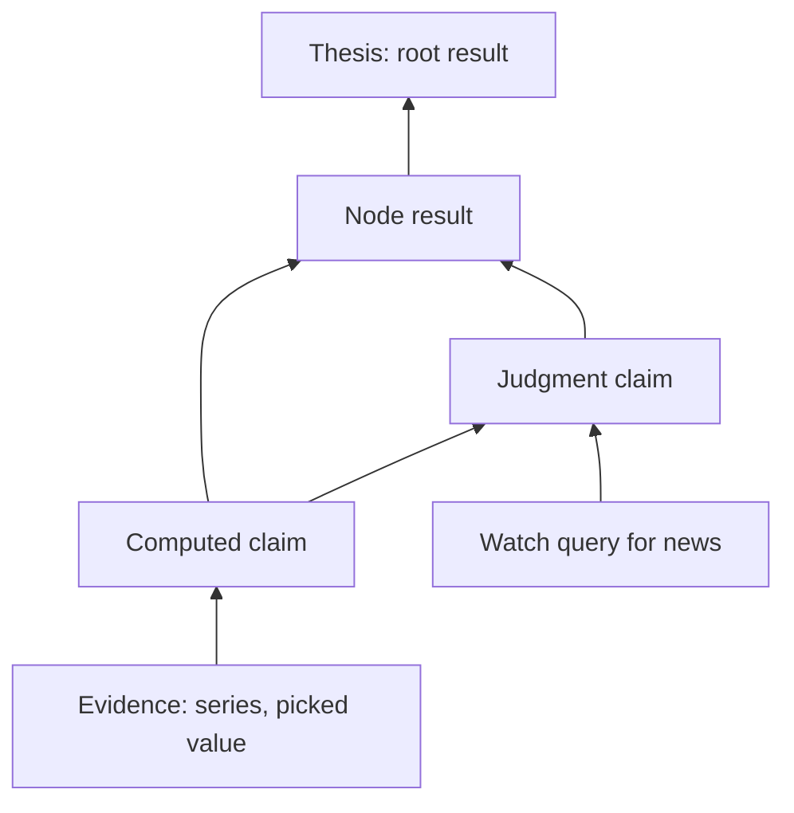
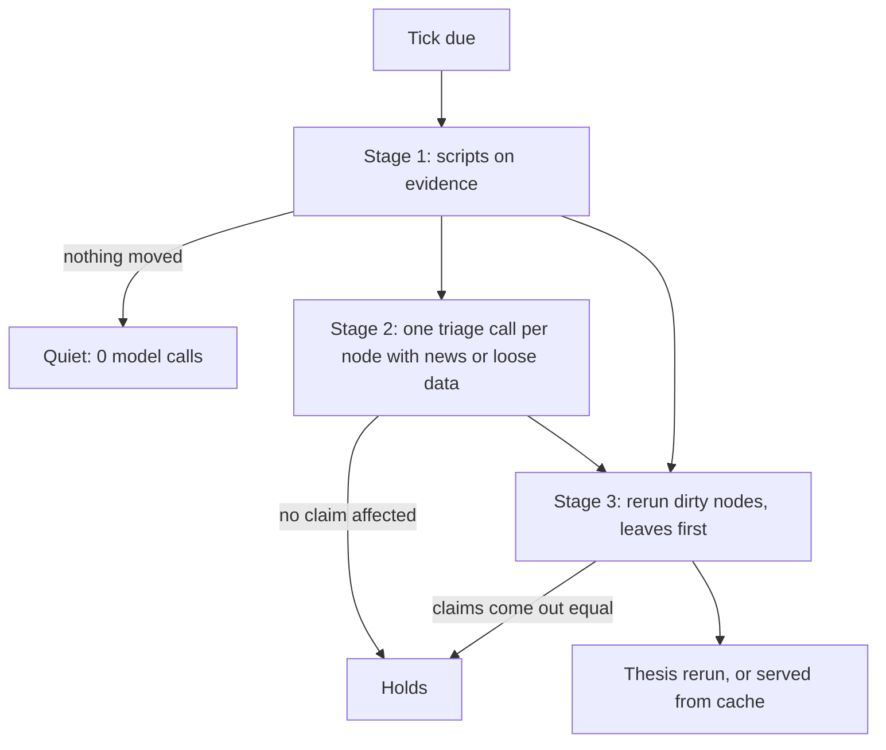

# Investment research harness: specification v5.1

An always-on research agent whose every result is a justification graph, checked by scripts first and a model last.

**Superseded by [v5.2](../harness-spec-v5.2/README.md)**, which replaces the claim graph with free prose and two kinds of inline citation, and moves the tick to node granularity.

Status: design, 2026-11-16. Replaces [v5.0](../harness-spec-v5/README.md). Nothing here is built except where a line says **measured**; those numbers come from [the sharing experiment](../../experiments/sharing/FINDINGS.md) and [the delta trace prototype](../../experiments/delta/trace.mjs).

This harness is for discretionary investing and portfolio management. It is not a generic agent runtime.

---

## 0. On one screen

- **A node is one task in one PTC session.** It runs a skill or none. Nodes fan out recursively by opening child nodes.
- **Six host calls**, unchanged since v3. A node's final message is its result.
- **Data calls have identity.** An identical call in the same world joins the one in flight or reuses its stored output.
- **The graph is built with handles.** In its cells a node calls `cite()` on data and `claim()` on what it concludes. Each returns a handle. A node can only cite what it holds a handle for.
- **One record shape.** Every artifact is text plus the handles it rests on. A three-line thesis expands, handle by handle, down to every source.
- **Three kinds of graph node.** Evidence is checked by script. A computed claim is recomputed by script. A judgment claim needs a model, and only when something beneath it moved.
- **The agent is always on, and mostly idle.** A schedule runs the scripts. A tick where nothing moved costs no tokens.
- **The tick has three stages.** Scripts on evidence; one small model call per node for news and uncited data; then a live rerun of the nodes that are dirty, with every other node answered from cache.
- **A slower check ignores the graph.** A weekly blind re-derivation looks for what the thesis never read.
- **Records are immutable and carry two times.** Any view can be rebuilt as of any past moment.



---

## 1. What changed from v5.0

| Area | v5.0 | v5.1 |
|---|---|---|
| Building the graph | The node writes refs in square brackets; the host parses the prose | The node mints handles in code with `cite()`, `claim()` and `watch()` |
| Delta check | Three passes, with cell replay as the model-free filter | A scheduled tick: scripts on evidence, one triage call per node, then reruns |
| Model-free filter | Re-run the node's cells and compare the shown output | Re-run the recorded pick and the computed claims |
| Waking a node | Reopen the saved session, or fork it | A fresh run that is handed its prior result, the diff, and its prior children by handle |
| Running | A function called per delta | An always-on shell: inbox, timers, one worker per thesis, outbox |
| Missing links | Not covered | A weekly graph-free check, and a check on unexplained price moves |
| Thesis | Claims and assumptions | Also expectations, kill criteria, watch queries and review dates |
| Peer messages and peer reopen | Core | Kept in the call surface, marked unproven |

### Decisions taken (2026-11-16)

| Decision | Choice |
|---|---|
| How a node records claims | Handles in code |
| How a dirty node is rerun | A fresh run with its prior result |
| Node-to-node features | Keep the six calls; fan-out, join, reuse and broadcast data lines are core; peer messages and peer reopen are demoted |
| Portfolio-manager layer | The thesis object only. The valuation link, the book view and the triage screen are deferred |
| Data fetched but never cited | Hash the whole output; on change, one triage call for that node |
| Deciding a claim came out equal | The database decides: claims are stored by content hash, and equal content is the same row. No model judges equivalence |
| Triage model | Haiku 5.5 |
| Schedule | A cron schedule per thesis, plus its review dates. The blind check runs weekly, or sooner on an unexplained price move |

### Why cell replay was replaced

The v5.0 prototype replays a node's cells against changed data and compares what the model was shown. **Measured:** 1,223 of 1,285 saved cells reproduce exactly, so it works. It also needs interpreter state restored cell by cell. A recorded pick is a pure function of one call's output: it can be re-run alone, by a cron script, with no interpreter state. Cells are still recorded for audit.

---

## 2. Records and refs

### 2.1 The rule

Every stored thing is a **record**: an immutable payload, a SHA-256 digest, and the two times of section 3. A record is never updated or deleted in place.

- A correction is a new record with a `replaces` edge to the old one.
- "Current" is a **head**: a pointer that moves by compare-and-swap. Each move is journaled.
- A **view** is computed from records as of a journal position. A view name is not a record.

### 2.2 Ref grammar

| Ref | Record | Created by |
|---|---|---|
| `s:cpi_yoy@v3` | A source vintage | Ingestion |
| `w7` | A world: an as-of cut of the sources, plus any overrides | Host |
| `n5` | A node (view: request, opener, state, refs) | Host |
| `n5.d3` | A stored call output | Host, when a data call runs |
| `n5.ev2` | Evidence: a call output plus the part relied on | The node, with `cite()` |
| `n5.cl4` | A claim: computed or judgment | The node, with `claim()`; the host, from each result line |
| `n5.w1` | A watch: a standing search | The node, with `watch()` |
| `n5.r2` | A result version | The node (its final message) |
| `n5.c1` | A checkpoint | The node |
| `n5.x3`, `n5.e4` | A cell; a trail entry (one model turn) | Host |
| `tk12` | A tick: what was checked, what moved, what ran | Host |
| `you.m1` | A message from you | You |
| `run`, `n5.trail` | Views: the index; a node's entries and cells | Host |

### 2.3 One shape, two hashes

Every graph node is the same shape:

```json
{"ref": "n5.cl4", "kind": "judgment", "text": "Debt is open but dearer.", "value": null,
 "rests_on": ["n5.cl3", "n5.ev2"], "content_sha": "…", "basis_sha": "…"}
```

```text
content_sha(evidence) = H(call identity, pick source, H(picked value))
content_sha(claim)    = H(kind, text, value)
basis_sha(x)          = H(content_sha(x), basis_sha of each item in rests_on, in order)
```

- **`content_sha` says what the claim states.** Two claims with the same content are the same row in the database. This is how equality is decided.
- **`basis_sha` says what it states and everything it rests on.** If a thesis's `basis_sha` is unchanged, nothing beneath it changed.
- A claim can keep its content while its basis changes: the same sentence, now resting on a newer vintage. That is a **re-base**, done by script, and it does not disturb the claim's parents.

---

## 3. Time and worlds

Unchanged from v5.0, in brief.

**A source vintage** carries `event_time` (the period described), `published_at`, `available_at` (when a participant with this scope could have had it) and `ingested_at`. A read adds the journal position at which a node observed it.

| Question | Filter |
|---|---|
| What was knowable at T? | `available_at <= T` and scope |
| What did we know at T? | The above, plus ingested by T, plus a recorded read by T |
| What do we know now about T? | The latest vintage for that `event_time` |

**A world** decides which vintage a read returns.

```text
world { ref, parent, kind: live | scenario | backtest | hindsight, as_of, scope, overrides, model_cutoff }

resolve(world, source):
  if world.overrides has source:  return a synthetic vintage  s:<source>@<world.ref>
  v = latest vintage of source with available_at <= world.as_of and scope allowed
  if v is none:                   fail                      # fail closed, never "latest"
  return v
```

- The live world advances as sources arrive. Each step is a new immutable world.
- A world's `scope` is the wall. Refs never cross scopes.
- A backtest whose `as_of` is earlier than `model_cutoff` is marked **contaminated**: the model may already know the outcome.

---

## 4. Nodes and calls

### 4.1 The six calls

| Call | What it does |
|---|---|
| `readNode({node})` | Loads a skill's procedure and links. Nothing runs |
| `readArtifact({ref, offset, limit, at})` | Reads a bounded slice of any record or view in the run, optionally as of a past moment |
| `openNode({request})` | Starts a node, joins identical running work, or reuses its latest valid result |
| `nextNodeEvent({after, filter})` | Returns this node's view of the journal since the cursor, or waits |
| `closeNode({handle})` | Releases this hold |
| `publishCheckpoint({content, to})` | Publishes a checkpoint. `to` addresses a node or `you` |

**The request** is `{task, node?, inputs?, refs?, world?, from?, key?}`. **Identity** is the pinned registry and model plus those fields. Who asks is not part of it.

| Identical work is | `openNode` |
|---|---|
| absent | starts a node |
| running | joins it |
| finished and valid in the caller's world | reuses its latest result |
| finished but not valid (section 8.6) | reruns it |
| failed or cancelled | starts a fresh node |

A node cannot end while it holds unfinished work.

### 4.2 Core and demoted

| Feature | Status |
|---|---|
| Recursive fan-out, join, reuse | Core |
| Call identity for data | Core. **Measured:** duplicate fetches fell from 3.4 to 0 per run |
| Broadcast data lines (a title and first sentence per fetched item) | Core. **Measured:** the winning arm, 30 of 55 checks against 25 without them |
| Peer messages, peer reopen | Available through `publishCheckpoint({to})`. **Measured:** unused in 186 runs. Nothing in this spec depends on them |
| Stream views and filters | Available. The right default for large runs is not settled |

### 4.3 Data calls

```js
const s = await world.series('utility_spreads')          // {points, unit, ref: 'n5.d3'}
const d = await world.doc('pellham-offering')            // {title, body, ref: 'n6.d2'}
const r = await world.search('utility equity issuance')  // {docs, series, ref: 'n6.d1'}
const v = await load('n2.d4')                            // a stored output, into code, not shown
```

```text
world_call(node, tool, args):
  key = hash(tool, canonical(args), what node.world resolves these args to)
  hit = calls[key]
  if hit and hit.running:   join it;          line "n6 joined n5.d5 · doc pellham-offering"
  elif hit:                 reuse its output; line "n6 reused n5.d5 · doc pellham-offering"
  else:                     fetch;  store as node.d<J>;  line "n5.d3 · series utility_spreads · … latest 2026Q3 165"
  record call {ref, tool, args, world, resolved, output_sha, by}
```

---

## 5. The graph primitive

### 5.1 Four bindings

```js
// Evidence: a call output, plus a pure function that picks the part relied on.
const ev = cite(s, x => x.points.at(-1))                          // → handle n5.ev1, value ['2026Q3', 165]

// A computed claim: code over evidence. The host can recompute it with no model.
const c1 = claim(([q, bp]) => `Utility spreads are ${bp}bp in ${q}`, [ev])          // → n5.cl1

// A judgment claim: the node's own conclusion, resting on handles. `while` is an optional tripwire.
const c2 = claim('Debt is open but dearer', [c1, ev2], {while: ([q, bp]) => bp < 200})   // → n5.cl2

// A watch: a standing search. New matches are news for this node.
const w = watch('Caldrian utility equity issuance')               // → n5.w1
```

| Binding | Stores | Checked on a tick by |
|---|---|---|
| `cite(output, pick?)` | The call, the pick's source, the picked value and its hash | Script: refetch, re-run the pick, compare hashes |
| `claim(fn, [handles])` | The function's source, its inputs, the text and value it returned | Script: re-run the function on the new values |
| `claim(text, [handles], {while?, review_by?, name?})` | The text, what it rests on, the tripwire's source | Script if the tripwire passes; otherwise a model |
| `watch(query)` | The query and a fingerprint of the current result set | Script: re-run the query, compare fingerprints |

Rules:

- **A pick and a computed claim are pure.** They get their inputs and nothing else: no data calls, no clock, no randomness. The host stores their source and runs them in a sandbox.
- **`cite()` with no pick** relies on the whole output. Any change in it counts.
- **A handle is the only way to cite.** `claim()` rejects anything that is not a handle this node holds: its own, or one read from a child's result. So "cited must have been seen" holds by construction.
- **`name`** gives a claim a stable name across reruns, such as `cuts_2027`.

### 5.2 The result

The final message is short prose. Each line that asserts something ends with the handles it rests on:

```markdown
**Plans slip rather than cancel.** [n5.cl2 n6.cl1]

- Debt is open but dearer. [n5.cl2]
- Equity is shut: Pellham pulled its offering. [n6.cl1]
- Pellham keeps its Q1 2027 tender on schedule. [assume; review by 2027-01-15]
```

On publish the host:

```text
publish(node, text):
  for each asserting line:
    handles = the bracketed handles; each must be one this node holds          # else reject, naming it
    mint a judgment claim {text: line, rests_on: handles}                      # a result line is a claim
  lines with no bracket and no [assume]: one notice, then accepted as resting on everything the node cited
  result = {text, rests_on: [the line claims]}
  compute content_sha and basis_sha bottom-up
  in one transaction: store the claims, the result and the edges; append the journal line
      "n5.r1 · Plans slip rather than cancel. · 4 claims · rests on 9 evidence"
```

- **A thesis is the root's result.** It is short because it cites; the detail is one handle away. Its first line is the **action**.
- **Depth comes from recursion.** A parent's lines cite its children's claims, which cite their children's, down to evidence.
- **Shared evidence is one node.** Two branches that cite the same call share it, through call identity.
- **Assumptions are explicit.** A line marked `[assume]` rests on nothing and must carry a review date.

### 5.3 Loose data

A call output the node fetched but never passed to `cite()` is **loose**. The node saw it, so it may have shaped the result. The host keeps its whole-output hash. When it changes, the node gets one triage call (section 8.3).

**Measured:** when citing was optional, only 15% of result lines cited anything. Whether nodes mint handles reliably is the first thing to test.

### 5.4 The thesis object

The root's result, plus four things the tick and the portfolio manager need:

| Part | Written as | Used for |
|---|---|---|
| Expectations | `expect('s:cpi_yoy', {event_time: '2026-11', value: 0.3}, {by: '2026-12-11'})` | Recorded before a catalyst. When the number arrives, surprise is actual minus expected, computed by script |
| Kill criteria | `claim('Order growth stays above 10%', [ev], {kill: ([g]) => g < 0.10})` | When a kill predicate turns true, the tick asks the manager to decide |
| Watch queries | `watch(query)` | News the thesis has not seen yet |
| Review dates | `{review_by}` on any claim or assumption | A timer. The claim's owner reruns when it comes due |

Deferred to a later version: the link from claims to a valuation, the book grouped by shared assumptions, the triage screen, and manager overrides.

---

## 6. The trace

All edges are recorded by the host.

| Edge | From → to | Recorded when |
|---|---|---|
| `resolved` | Call → source vintage, or search → result fingerprint | The call runs |
| `picked` | Evidence → call | `cite()` |
| `rests_on` | Claim → evidence or claim; result → claim | `claim()`, publish |
| `replaces`, `kept`, `withdrawn` | Claim → prior claim; result → prior result | A rerun |
| `fetched` | Node → loose call | A data call with no `cite()` |
| `opened`, `forked_from` | Node → node; world → world | `openNode` |
| `checked` | Tick → claim, with the outcome | A tick |

Views, read through `readArtifact` and wrapped as `trace.*`:

```text
up(ref):        follow rests_on, picked and resolved down to source vintages and assumptions
down(ref):      follow the same edges upward to every claim, result and thesis that rests on it
timeline(thesis):
  for each version of the thesis, for each source vintage in up(version):
    row {available_at, first observed by this run, source, the path to the thesis, which claim versions it changed}
  sorted by available_at
at(view, T):    rebuild the view from records and heads as they stood at T
```

`timeline` answers "what did this decision rest on, when did each piece exist, and when did we see it?". `at` answers "what did we hold on that date, and why?".

---

## 7. The always-on shell

The agent is not running most of the time. It wakes on an event, works, saves, and sleeps. The shell follows the five primitives in Anthropic's [Building always-on agents](https://claude.com/resources/articles/building-always-on-agents), with one addition.

| Primitive | In this harness |
|---|---|
| Event inbox | One durable inbox per thesis. Events: a tick came due, a watched source has a new vintage, the manager sent a message. Events are deduplicated by source id |
| Timers | Schedules (the thesis's cron) and follow-ups (review dates, expectation dates). A timer never starts a run; the scheduler turns a due timer into an inbox event |
| Memory | The records of section 2. Each run loads only the thesis and its index; everything else is read by handle when needed |
| Permissions | Read-only data access. The harness never trades. Anything that needs the manager is a deferred question |
| Outbox | A tick ends one of three ways: a message (the thesis changed), nothing (it holds), or a deferred question (a kill criterion fired) |

- **One worker per thesis.** Two ticks never run on one thesis at once. Events that arrive during a tick wait for the next one and are batched into it.
- **Start quiet.** A tick that changes nothing sends nothing. It still writes a tick record, so silence can be audited.
- **Past messages are kept**, so the same change is not announced twice.
- **The addition: scripts before the model.** The article does not cover cheap checks ahead of a model call. Here the scheduler's work on a due tick is stage 1 of section 8, which is all scripts.

How the records line up with Anthropic's [The components of agent memory](https://www.anthropic.com/research/components-of-agent-memory):

| That article | Here |
|---|---|
| Transcripts: the base layer and the ground truth | Trails and the journal |
| Notes that record a rule and how the agent knows it is true | A claim and what it rests on |
| Representations: linked pages, one per entity | One record per claim and node, linked by handles |
| A small injected top layer | The short thesis |
| Dreaming: an offline pass that checks notes against transcripts | The graph-free check of section 9 |

That article also warns against over-recording. Host logging is automatic and can be exhaustive. Claims are written by the model and should be few.

---

## 8. The tick

### 8.1 Overview



### 8.2 Stage 1: scripts

```text
tick(thesis, w_new):
  pin(w_new);  tk = new tick record;  flagged = {}

  for ev in live evidence under thesis:
    out = refetch(ev.call, w_new)                     # through call identity: one fetch per distinct call
    v   = ev.pick(out)
    if H(v) != ev.value_sha:  moved.add(ev, old value, v)

  for call in loose calls under thesis:
    if H(refetch(call, w_new)) != call.output_sha:  loose.add(call)

  for w in watches under thesis:
    now = run(w.query, w_new)
    if fingerprint(now) != w.fingerprint:  news.add(w, items in now that are new)

  for x in expectations due:  tk.surprises.add(x, actual - x.value)
  due = claims whose review_by <= w_new.as_of

  # Push the moved values up through code.
  for cl in claims resting on anything in moved, directly or through a changed computed claim, in dependency order:
    if cl is computed:
      new = cl.fn(new values of its inputs)
      if content differs: changed.add(cl, old, new)   # a new claim record that replaces the old
      else:               rebase(cl)
    else:                                             # judgment
      if cl.kill and cl.kill(new values):  tk.ask.add(cl)
      if cl.while and cl.while(new values): rebase(cl)        # the tripwire passed: same content, new basis
      else:                                 flagged.add(cl)

  if moved, loose, news and due are all empty:
    tk.outcome = "quiet";  commit(tk);  return        # no model call, no message
```

### 8.3 Stage 2: triage

One call per node that has news or loose data, batching all of that node's items.

```text
triage(node, items):                                  # model: claude-haiku-5-5
  input:  the node's task
          its claims, as handle and text
          for news: each new item's title and first sentence
          for loose data: the first changed lines, old and new
  output: {affected: [claim handles], reason}         # an empty list means none
  record the call: model, input hash, output

for node with news or loose items:
  flagged.add(triage(node, items).affected)
```

A miss here is caught only by the graph-free check, so the triage miss rate is something to measure.

### 8.4 Stage 3: rerun

```text
  dirty = owners of flagged ∪ owners of due
  queue = dirty, leaves first                         # a parent waits for all of its dirty children

  while queue is not empty:
    n = queue.pop()
    r = rerun(n, brief(n))                            # a fresh session; section 8.5
    for each prior claim p of n:
      kept      if r holds a claim with the same content_sha        # the database decides
      replaced  if r minted a claim with replaces: p
      withdrawn otherwise
    publish n.r(V+1) if anything was replaced, withdrawn or added; else rebase n's result
    for cl in claims of other nodes resting on a replaced or withdrawn claim:
      apply the stage 1 test to cl; if it is flagged, queue its owner

  # The root is a node like any other. Its first line is the action.
  if the root's action claim changed content:     tk.outcome = "changed";  outbox.send(what changed, and why)
  elif any other root claim changed:              tk.outcome = "holds, support revised"
  else:                                           tk.outcome = "holds"
  if tk.ask is not empty:                         outbox.ask(the manager, tk.ask)       # a deferred question
  commit(tk)                                      # what was checked, moved, triaged and rerun, in world w_new
```

- **A node that is not dirty is answered from cache.** Its result stands, re-based if anything beneath it was re-based.
- **The wave stops where content is equal.** A rerun that keeps every claim publishes no new version, and its parents are not queued.
- **The root reruns only if a claim it rests on changed content.** Otherwise the cached thesis is served, stamped by the tick.
- **A message is sent only when the action changes.** A rerun root that keeps its action and revises a supporting line is recorded, not announced.

### 8.5 The rerun brief

A dirty node is run again in a fresh session. It does not resume its old one.

```text
brief(n):
  the task, unchanged
  your prior result, and your prior claims as handle, text and what each rests on
  what moved:
    evidence:  n5.ev1  ['2026Q3', 165] → ['2026Q3', 190]     (s:utility_spreads@v1 → @v2)
    news:      the new items for your watches
    children:  n6.cl1 was replaced: old text → new text
  your prior children, by handle, each marked "valid" or "rerun, changed"
  drift: for each named claim, its value when the thesis last changed, and now
  "Keep a prior claim by citing its handle. Replace it with claim(…, {replaces: handle}).
   Read your children by handle; open a new child only for a new question."
```

- **Prior children come by handle,** so the node does not re-ask in new words and miss the cache.
- **Unchanged data is not refetched.** The node's data calls go through call identity and reuse stored outputs that are still valid.
- **Drift is shown against the last change,** not the last tick, so a slow slide is visible.
- The old session's trail is kept. A node has one trail per run.

### 8.6 Validity

The same test answers "is this cached result still good?" for a tick, for `openNode`'s reuse rule, and for a fork:

```text
valid_in(result, w):
  every evidence under it has the same picked-value hash in w
  every loose call under it has the same output hash in w
  every watch under it has the same fingerprint in w
  no claim under it is past its review date at w.as_of
```

### 8.7 Outcomes

| Outcome | Model calls | Message |
|---|---|---|
| Quiet: nothing moved | 0 | None |
| Moved, absorbed by scripts: computed claims updated, tripwires passed | 0 | None |
| Triage says no claim is affected | 1 small call per node with news or loose data | None |
| Belief revision: claims below the root changed and the root was not affected | 1 per rerun node | None |
| Support revised: the root was rerun and kept its action | 1 per rerun node, including the root | None |
| Thesis revision: the action changed | 1 per rerun node, including the root | Sent |
| Kill criterion fired | As above | A question to the manager |

---

## 9. The graph-free check

The graph proves that nothing the thesis read has changed. It cannot show that nothing it should have read has changed. Two checks ignore the graph.

```text
blind_check(thesis):                                  # weekly, or sooner on an unexplained price move
  fresh   = run the root task as a new run, in the live world, with no access to the thesis's records
  missing = sources fresh cited that the thesis never read
  differs = one model call comparing fresh's claims with the thesis's claims
  publish a check record {missing, differs}
  add a watch for each missing source
  if differs is material: outbox.send(only the differences)

unexplained_move(position):                           # a script, on each tick
  if |return| is large against its own history and no evidence under the thesis moved:
    open a node: "Why did this move?"                 # its findings become candidate evidence and watches
    bring the blind check forward
```

- A blind run shares fetched data with the thesis through call identity. It does not share claims or framing.
- The share of thesis revisions that only these checks caught is the **escape rate**. It sets how often the blind check needs to run.
- A cheap script pass also checks each claim against its evidence: that every handle resolves, and that numbers in a claim's text appear in what it rests on.

---

## 10. Forks: scenarios, backtests and outcome review

A fork is a tick against a different world. Nothing is copied; a **branch** is a set of heads over shared records.

```text
scenario(thesis, overrides, label, p?, resolution_rule?):
  w_s = worlds.fork({from: thesis.world, overrides, label, kind: "scenario"})
  b   = branch(thesis, world = w_s)
  tick(b, w_s)                                        # the live heads never move
  publish scenario {branch: b, world: w_s, overrides, p, resolution_rule, thesis: b.root.head}

backtest(task, T, scope):
  w_b = worlds.at({as_of: T, scope, kind: "backtest"})
  run the task in w_b                                 # every read fails closed without a vintage available by T
  mark contaminated if T < w_b.model_cutoff

on_outcome(thesis, actual):                           # the number you were waiting for arrives
  tick(thesis, world_after(actual))                   # 1. the live thesis moves forward; surprise is computed
  for f in forecasts whose rule matches actual:       # 2. the forecast is scored; it is never edited
    append resolution {forecast: f, outcome: actual, score}
  t0  = the thesis version held before the release    # 3. hindsight
  w_h = worlds.fork({from: t0.world, overrides: [actual], kind: "hindsight"})
  b_h = branch(thesis at t0, world = w_h);  tick(b_h, w_h)
  publish lesson {thesis: t0, hindsight: b_h.root.head, actual,
                  claims that would have changed, assumptions that failed}
```

- A scenario's probability and resolution rule are frozen when published.
- Nodes that never read an overridden source are valid in the scenario world and are answered from cache.
- The gap between the original thesis and the hindsight branch separates a bad call from bad luck.
- Two candidate heads for one thesis: one wins by compare-and-swap, the other stays stored.

---

## 11. Storage

One SQLite database in WAL mode per book, content-addressed blobs for payloads, Parquet for market series. Sources and worlds are shared across theses within a scope.

```sql
CREATE TABLE events (            -- the journal: the only append point
  seq INTEGER PRIMARY KEY AUTOINCREMENT, run TEXT NOT NULL, node TEXT, actor TEXT NOT NULL,
  kind TEXT NOT NULL, ref TEXT, line TEXT, caused_by TEXT, world TEXT,
  recorded_at TEXT NOT NULL, scope TEXT NOT NULL
);
CREATE TABLE records  (ref TEXT PRIMARY KEY, kind TEXT NOT NULL, sha256 TEXT NOT NULL, blob TEXT NOT NULL,
                       run TEXT, node TEXT, world TEXT, seq INTEGER NOT NULL, scope TEXT NOT NULL);
CREATE TABLE vintages (ref TEXT PRIMARY KEY, source TEXT NOT NULL, kind TEXT NOT NULL, event_time TEXT,
                       published_at TEXT, available_at TEXT, ingested_at TEXT NOT NULL,
                       replaces TEXT, scope TEXT NOT NULL, sha256 TEXT NOT NULL);
CREATE TABLE worlds   (ref TEXT PRIMARY KEY, parent TEXT, kind TEXT NOT NULL, as_of TEXT NOT NULL,
                       scope TEXT NOT NULL, overrides TEXT, model_cutoff TEXT);
CREATE TABLE nodes    (run TEXT, id TEXT, request TEXT NOT NULL, identity TEXT NOT NULL,
                       opener TEXT, world TEXT NOT NULL, PRIMARY KEY (run, id));
CREATE TABLE calls    (ref TEXT PRIMARY KEY, identity TEXT NOT NULL, tool TEXT NOT NULL, args TEXT NOT NULL,
                       world TEXT NOT NULL, resolved TEXT NOT NULL, output_sha TEXT NOT NULL,
                       effect TEXT NOT NULL);                     -- planned | started | committed | failed
                                                                  -- a call with no evidence row is loose
CREATE TABLE evidence (ref TEXT PRIMARY KEY, call TEXT NOT NULL, pick_src TEXT,
                       value TEXT NOT NULL, value_sha TEXT NOT NULL);
CREATE TABLE claims   (ref TEXT PRIMARY KEY, node TEXT NOT NULL, kind TEXT NOT NULL,   -- computed | judgment | assumption
                       name TEXT, text TEXT NOT NULL, value TEXT, fn_src TEXT, while_src TEXT, kill_src TEXT,
                       review_by TEXT, replaces TEXT, content_sha TEXT NOT NULL, basis_sha TEXT NOT NULL);
CREATE INDEX claims_by_content ON claims (content_sha);
CREATE TABLE watches  (ref TEXT PRIMARY KEY, node TEXT NOT NULL, query TEXT NOT NULL, fingerprint TEXT NOT NULL);
CREATE TABLE expectations (ref TEXT PRIMARY KEY, node TEXT NOT NULL, source TEXT NOT NULL,
                       event_time TEXT, value TEXT NOT NULL, due TEXT NOT NULL, resolved_by TEXT);
CREATE TABLE edges    (src TEXT NOT NULL, rel TEXT NOT NULL, dst TEXT NOT NULL, seq INTEGER NOT NULL,
                       PRIMARY KEY (src, rel, dst, seq));
CREATE INDEX edges_by_dst ON edges (dst, rel);                    -- "what rests on this?" is one lookup
CREATE TABLE entries  (ref TEXT PRIMARY KEY, parent TEXT, run TEXT, node TEXT, model TEXT,
                       manifest_sha TEXT, output TEXT, seq INTEGER NOT NULL);
CREATE TABLE cells    (ref TEXT PRIMARY KEY, entry TEXT NOT NULL, code TEXT NOT NULL,
                       shown TEXT NOT NULL, shown_sha TEXT NOT NULL, error TEXT);
CREATE TABLE ticks    (ref TEXT PRIMARY KEY, thesis TEXT NOT NULL, world TEXT NOT NULL, outcome TEXT NOT NULL,
                       summary TEXT NOT NULL, seq INTEGER NOT NULL);
CREATE TABLE inbox    (id INTEGER PRIMARY KEY, thesis TEXT NOT NULL, source_id TEXT NOT NULL, kind TEXT NOT NULL,
                       payload TEXT, status TEXT NOT NULL, UNIQUE (thesis, source_id));
CREATE TABLE timers   (id INTEGER PRIMARY KEY, thesis TEXT NOT NULL, kind TEXT NOT NULL,      -- schedule | follow-up
                       cron TEXT, due TEXT NOT NULL, ref TEXT, status TEXT NOT NULL);
CREATE TABLE outbox   (id INTEGER PRIMARY KEY, thesis TEXT NOT NULL, tick TEXT NOT NULL, kind TEXT NOT NULL,  -- message | question
                       body TEXT NOT NULL, status TEXT NOT NULL);
CREATE TABLE heads    (name TEXT PRIMARY KEY, ref TEXT NOT NULL, revision INTEGER NOT NULL);   -- moved by compare-and-swap
```

- **Append-only:** everything except `heads` and the `status` columns of `inbox`, `timers` and `outbox`. Every head move is also an event.
- **The publish transaction:** stage the blob and flush it; then in one database transaction insert the records, edges and event, and move the head if its revision is still the expected one. No event ever names a missing blob.
- **Equality is a lookup:** `SELECT ref FROM claims WHERE content_sha = ?`.
- **Projections are rebuildable** from the journal and blobs.
- **Recovery** resumes at the last committed cell. A tick that crashed is retried from the inbox event; its scripts are safe to repeat.

---

## 12. Skills

A skill-free node and a skill node run on the same host path. A skill adds a procedure, and can declare what its node must publish: claim names, tripwires, review dates and resolution rules. That makes a recurring task's output line up from one run to the next. A skill revision invalidates only the nodes that consulted the old version.

Skills are also where lessons from outcome review land.

---

## 13. Walkthrough

One thesis, four moments. Refs and values are illustrative.

**T0 · the thesis.** You ask whether to add to XLI LEAPS. The root opens three nodes. Inside `n2`:

```js
const cpi  = await world.series('cpi_mom')
const ev1  = cite(cpi, x => x.points.at(-1))                                   // ['2026-10', 0.3]
const fut  = await world.series('fed_funds_futures')
const ev2  = cite(fut, x => impliedCuts(x.points, 2027))                       // 2
const cuts = claim(n => `Futures price ${n} cuts in 2027`, [ev2], {name: 'cuts_2027'})
const ok   = claim('Inflation is not forcing the path higher', [ev1, cuts], {while: ([[, m], n]) => m <= 0.3 && n >= 2})
expect('s:cpi_mom', {event_time: '2026-11', value: 0.3}, {by: '2026-12-11'})
watch('Federal Reserve guidance on 2027 path')
```

```markdown
n1.r1 · the thesis
**Add a half position now.** [n1.cl1 n1.cl2 n1.cl3]
- Two cuts support multiples. [n2.cuts_2027 n2.cl2]
- Orders are rising. [n3.cl4]
- Implied volatility is at its median. [n4.cl2]
```

**T1 · a quiet morning.** The 07:00 tick refetches 14 evidence items, 3 loose calls and 4 watches. Nothing differs. `tk1: quiet`. No model call, no message.

**T2 · a revision.** October CPI is revised to 0.4%.

```text
stage 1   n2.ev1 moved: 0.3 → 0.4.  n2.cl2's tripwire fails (0.4 > 0.3): flagged.
stage 2   no news, no loose data: skipped.
stage 3   n2 rerun with a brief.  It keeps cuts_2027 and replaces n2.cl2:
            "Inflation is firmer, but futures still price two cuts."
          n1's first line rests on n2.cl2, which was replaced: n1 is rerun.
          n1 keeps its action, "Add a half position now", and replaces one supporting line.
tk2       outcome: holds, support revised.  Model calls: 2.  n3 and n4 from cache.  No message.
```

**T3 · news.** A new document matches `n2`'s watch.

```text
stage 1   n2.w1 fingerprint changed: one new item.
stage 2   triage(n2), given the speech's title and first sentence → affected: [n2.cl2]
stage 3   n2 rerun: it reads the speech and replaces n2.cl2:
            "Guidance now points to one cut; futures have not repriced yet."
          n1 rerun: its action is replaced by "Hold; do not add."
tk3       outcome: changed.  Model calls: 1 triage and 2 reruns.
          Message sent: what changed, and the path from the speech to the action.
```

**T4 · the outcome.** November CPI prints 0.5%.

```text
tick      surprise: 0.5 - 0.3 = +0.2.  The thesis moves to "trim".
score     the expectation is resolved; the forecast record is untouched.
hindsight a branch of the T0 thesis in a world holding the true print: "wait" in place of "add".
lesson    the T0 add rested on one expectation; with the true number the call flips.
```

`trace.timeline(n1)` returns every vintage the thesis ever rested on, in the order the world published them. `trace.at(n1, T0)` still returns `n1.r1` exactly as it stood.

---

## 14. Conformance tests and the first benchmark

**Graph**
- `claim()` with a handle the node does not hold: rejected, naming it.
- A result line citing a handle the node does not hold: rejected.
- Two claims with the same text and value: one `content_sha`, found by one lookup.
- A thesis whose evidence is unchanged: its `basis_sha` is unchanged.
- A pick or computed claim that calls data, reads the clock or uses randomness: rejected when minted.

**Tick**
- 100 ticks against an unchanged world: 0 model calls, 0 messages, 100 tick records.
- A revision outside what a pick returns: nothing moved.
- A revision inside a pick, under a tripwire that still passes: the claim is re-based, no model call.
- A changed computed claim with no judgment claim resting on it: updated by script, no model call.
- A new document matching a watch: exactly one triage call for that node.
- Loose data changes: exactly one triage call for that node.
- A rerun that keeps every claim: no new result version, parents not queued.
- The root's inputs unchanged: the thesis is served from cache.
- A kill criterion turns true: a question reaches the outbox.
- Events arriving during a tick: handled by the next tick, in one batch.
- A claim past its review date with no new data: its owner is rerun.

**Shell**
- Two events with the same source id: one inbox row.
- Two workers on one thesis: the second does not start.
- A crash mid-tick: the tick is retried and produces the same tick record.

**Records, time and forks**
- A backtest world never returns a vintage made available after its `as_of`.
- `at(view, T)` returns the same bytes before and after later revisions.
- A scenario tick leaves every live head unchanged.
- An outcome never edits the expectation or forecast it resolves.

**The first benchmark.** Take finished runs as standing theses, inject planted deltas, and score against planted truth.

| Measure | Meaning |
|---|---|
| Missed revisions | Material deltas that left the thesis unchanged |
| Spurious revisions | The thesis changed with no cause |
| Model calls and cost per tick | Against a full re-run |
| Triage miss rate | Affected claims that Haiku answered "none" for |
| Handle coverage | The share of fetched data that was cited, and of result lines that cite |
| Rerun stability | How often a rerun keeps a claim whose inputs did not change |

Arms: a full re-run on every delta; one agent given its prior memo and the news; this design.

---

## 15. Open decisions

| Question | Default taken | What would settle it |
|---|---|---|
| Will nodes mint picks and claims reliably? | Required for result lines; one notice for uncited lines | Handle coverage in live runs |
| Are node-written tripwires too loose or too tight? | The node writes them; drift is shown on every rerun | Missed and spurious revisions in the benchmark |
| Is Haiku good enough for triage? | Haiku 5.5 | The triage miss rate |
| Does a fresh rerun keep stable claims? | Fresh, with the prior result and children by handle | Rerun stability |
| How often should the blind check run? | Weekly | The escape rate |
| Default stream view in large runs | Everything, until a cap | A larger-run test |
| Model look-ahead in backtests | Flag as contaminated | Whether an earlier-cutoff model is available |
| Peer messages and peer reopen | Kept, unproven | A run that needs them |

---

## 16. Build order

1. **Records.** Journal, blobs, the publish transaction, heads, `at`.
2. **Worlds and data calls.** Vintages, `resolve`, call identity, data lines.
3. **The graph primitive.** `cite`, `claim`, `watch`, the two hashes, result lines as claims.
4. **Stage 1 of the tick.** Scripts only. This can be prototyped on saved runs with no model cost.
5. **Stages 2 and 3.** Triage, the rerun brief, equality by content hash. The benchmark is run here.
6. **The shell.** Inbox, timers, one worker per thesis, outbox.
7. **The graph-free check.**
8. **Forks and outcome review.**
9. **The deferred manager layer.**

Each step is useful without the next.

---

## 17. References

- [Building always-on agents](https://claude.com/resources/articles/building-always-on-agents), Anthropic, 13 November 2026.
- [The components of agent memory](https://www.anthropic.com/research/components-of-agent-memory), Anthropic, 6 November 2026.
- [Build Systems à la Carte](https://www.microsoft.com/en-us/research/publication/build-systems-a-la-carte/): early cutoff and recorded traces.
- [Introducing Incremental](https://blog.janestreet.com/introducing-incremental/), Jane Street: self-adjusting computation.
- [An Assumption-Based TMS](https://www.dekleer.org/Publications/An%20Assumption-Based%20TMS.pdf), de Kleer: beliefs that carry their justifications, under many assumption sets.
