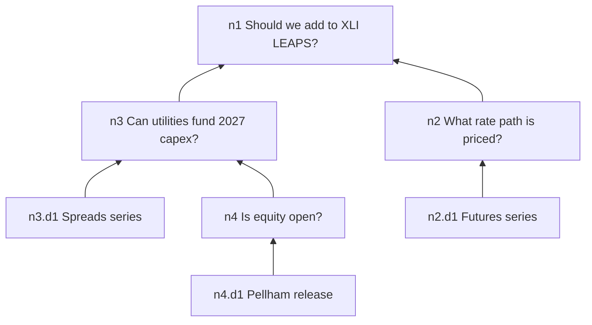

# Investment research harness: specification v5.2

Recursive PTC nodes that answer in cited prose, with citations a reader can click down to the raw tool output. The harness records everything and reruns only what moved.

Status: design, 2026-11-17. Replaces [v5.1](../harness-spec-v5.1/README.md). Nothing here is built except where a line says **measured**; those numbers come from [the sharing experiment](../../experiments/sharing/FINDINGS.md) and [the delta trace prototype](../../experiments/delta/trace.mjs).

This harness is for discretionary investing and portfolio management. It is not a generic agent runtime.

---

## 0. On one screen

- **A node is one question in one PTC session.** It answers in prose. It may open child nodes for sub-questions, and they may open their own. Skill-free nodes are the default; a skill suggests how to decompose.
- **The decomposition tree is the justification graph.** The harness records who opened whom, who read what, and which data calls fed which node. The model writes none of this.
- **Answers cite inline, in two ways.** `[n3.d1]` cites a tool output and opens it. `[equity is shut](n4.r1)` cites a child's answer: the words are underlined and open that answer, which has citations of its own. A reader can click from the thesis down to the raw data.
- **Citations are checked, never required.** A cited record must exist, be pinned to a version, and have been seen by the node that cites it.
- **Six host calls**, unchanged since v3. Data calls have identity: an identical call joins the one in flight or reuses its stored output.
- **Optional helpers** ask for script checks: `track` a value with a tripwire, `watch` a search, `expect` a number before a catalyst, `revisit` by a date.
- **Always on, mostly idle.** A scheduled tick runs scripts first, a small model only for news and untracked data, and reruns only the nodes whose inputs moved. A rerun node may answer `holds`, which stops the wave.
- **An outer loop learns.** It scores forecasts and market reactions, forks past sessions to ask what was missing, and proposes skill revisions that must pass held-out replay and a shadow run.
- **Records are immutable and carry two times.** Any view, including a rendered memo, can be rebuilt as of any past moment.



---

## 1. What changed from v5.1

### 1.1 Why

v5.1 built a claim graph inside each node: `claim()` handles, result lines that had to end in handles, and claim equality by content hash. In use, the final artifacts were plain: one-line claims, each restating a single tool result, with the reasoning missing. The format made citing easy and reasoning optional. v5.2 removes the format and keeps the mechanism.

### 1.2 Changes

| Area | v5.1 | v5.2 |
|---|---|---|
| Result | Lines ending in claim handles | Free prose with inline citations |
| Citations | Handles only; every asserting line must cite | Two kinds, data and node; checked, never required |
| The graph | Claims inside each node | The decomposition tree, plus citation edges |
| Early cutoff | Equal claim content hash | The rerun node answers `holds(reason)` |
| Script checks | `cite(output, pick)`, tripwires on claims | `track(output, pick, {while, kill})`, on the node |
| Tick granularity | Claim | Node. Citations make the rerun brief precise |
| Depth | Not addressed | Budgets, fan-in guidance, re-fan-out, critic children |
| Reader | Not specified | Click-through citations with version, time and staleness |
| Outer loop | Not specified | Event and reaction scoring, past-session forks, gated skill revisions |

### 1.3 Decisions

| Decision | Choice | Status |
|---|---|---|
| Claims | Free prose; no claim primitive | Decided 2026-11-17 |
| Citations | A data citation opens the tool output; a node citation is underlined and opens the child's answer | Decided 2026-11-17 |
| Format at fan-in | None fixed by the host; the parent's request says what it needs back | Decided 2026-11-17 |
| Dirty node | A fresh session with its prior answer | Kept from v5.1 |
| Triage model | Haiku 5.5 | Kept from v5.1 |
| Schedule | Cron per thesis plus review dates; weekly blind check | Kept from v5.1 |
| Name of the script-check helper | `track` (was `cite`, which now means inline citation) | Default |
| Budget | Visible to the node at every turn boundary | Default |
| Re-checking `holds` | 1 in 10 `holds` answers re-run blind | Default |
| Reaction tables | Optional; skills encourage them for catalysts that matter | Default |
| Skill promotion | Always needs manager approval | Default |
| Market context graph | Shared across the book within a scope | Default |

Defaults are open; section 17 lists what would settle each.

---

## 2. Design rules

1. **The host records; the model reasons.** The host owns provenance, time, identity, caching and replay. It does not tell the model how to think or how to lay out an answer.
2. **The test for hard-coding:** would a stronger model want this rule removed? If yes, it belongs in a skill or a default prompt, where the outer loop can change it.
3. **Check integrity, measure quality.** A citation to a record the node never saw is rejected. A memo that reasons badly is measured and graded, never rejected by a rule.
4. **Cheap iteration is the advantage.** Call identity, caching and early cutoff exist so a model can decompose further and revisit more without paying twice.

---

## 3. Nodes and calls

### 3.1 The six calls

| Call | What it does |
|---|---|
| `readNode({node})` | Loads a skill's procedure and links. Nothing runs |
| `readArtifact({ref, offset, limit, at})` | Reads a bounded slice of any record or view in the run, optionally as of a past moment. Recorded |
| `openNode({request})` | Starts a node, joins identical running work, or reuses its latest valid answer |
| `nextNodeEvent({after, filter})` | Returns this node's view of the journal since the cursor, or waits |
| `closeNode({handle})` | Releases this hold. Unfinished work is cancelled when its last holder leaves |
| `publishCheckpoint({content, to})` | Publishes a checkpoint, cited like a result. `to` addresses a node or `you` |

A node's final message is its result, `nK.rV`. A node cannot end while it holds unfinished work.

### 3.2 The request

| Field | Required | Meaning |
|---|---|---|
| `task` | yes | The question. The parent writes it, including what kind of answer it needs back |
| `node` | no | A skill to run. Omit for a skill-free node |
| `inputs`, `refs` | no | Structured inputs and an ordered list of refs to start from |
| `world` | no | A world ref. Default: the opener's world |
| `from` | no | Fork a saved session: `{node, entry}` |
| `key` | no | Forces a separate copy of otherwise identical work |
| `budget` | no | A spend cap for this node and everything it opens. Default: an even share of the opener's remainder |

**Identity** is the pinned registry and model, plus `task`, `node`, `inputs`, `refs`, `world`, `from` and `key`. It excludes `budget` and who asks.

| Identical work is | `openNode` | Line |
|---|---|---|
| absent | starts a node | `n3 opened n4 · Is equity issuance open?` |
| running | joins it | `n5 joined n4` |
| finished and valid in the caller's world (section 9.4) | reuses its latest answer | `n5 reused n4.r1` |
| finished, not valid | reruns it with its prior answer (section 9.3) | `n5 reran n4` |
| failed or cancelled | starts a fresh node | `n3 opened n6 · …` |

### 3.3 Budget

```text
open:        child.budget = request.budget or an even share of the opener's remainder; carved from the opener
each turn:   every batch from nextNodeEvent and every cell result ends with  "budget left: $0.84 of $2.00"
at zero:     one notice, "finish now with what you have"; the next turn is the last
after:       the answer is marked budget-capped in the run index
```

A thesis's schedule sets the budget for each tick's reruns and for a full run.

### 3.4 Core and unproven

| Feature | Status |
|---|---|
| Recursive fan-out, fan-in, join, reuse | Core |
| Call identity for data | Core. **Measured:** duplicate fetches fell from 3.4 to 0 per run |
| Data lines: a title and first sentence for each fetched item, sent to every node | Core. **Measured:** with the guidance paragraph, the winning arm: 30 of 55 checks against 25 for the same arm without them |
| Peer messages and peer reopen through `publishCheckpoint({to})` | Available, unproven. **Measured:** unused in 186 runs. Nothing in this spec depends on them |
| Stream views and filters | Available. The right default for large runs is not settled |

---

## 4. Data calls and helpers

### 4.1 Data calls

```js
const s = await world.series('utility_spreads')          // {points, unit, ref: 'n3.d1'}
const d = await world.doc('pellham-offering')            // {title, body, ref: 'n4.d1'}
const r = await world.search('utility equity offering')  // {docs, series, ref: 'n4.d2'}
const v = await load('n2.d4')                            // a stored output, into code, not shown
```

```text
world_call(node, tool, args):
  key = hash(tool, canonical(args), what node.world resolves these args to)
  if calls[key] is running:   join it;          observed(node) += ref;  line "n5 joined n3.d1 · series utility_spreads"
  elif calls[key] exists:     reuse its output; observed(node) += ref;  line "n5 reused n3.d1 · series utility_spreads"
  else:                       fetch under node.world;  store as node.d<J>;  observed(node) += ref
                              line "n3.d1 · series utility_spreads · Caldrian utility bond spreads (bp): latest 2026Q3 165"
  record call {ref, tool, args, world, resolved: [source versions] or {query, result fingerprint}, output_sha, by}
```

### 4.2 Helpers for script checks

All optional. A skill may suggest them; nothing requires them.

| Helper | Records | On a tick |
|---|---|---|
| `track(output, pick?, {while?, kill?})` | Which part of an output the node relied on, a tripwire, a kill criterion | Re-run the pick on the new output. Not dirty while the tripwire passes. A true `kill` asks the manager |
| `watch(query)` | A standing search and its result fingerprint | A new match is news for this node |
| `expect(source, value, {by, react?})` | A forecast before a catalyst, and optionally how the market should react | Scored when the number arrives (section 13) |
| `revisit(by)` | A review date for this node's answer | The node reruns when it comes due |

```js
const s = await world.series('utility_spreads')
track(s, x => x.points.at(-1)[1], {while: bp => bp < 200})      // dirty only if the latest point passes 200bp
watch('utility equity offering')
expect('s:cpi_mom', {event_time: '2026-11', value: 0.3}, {by: '2026-12-11', react: {hot: {XLI: -0.02}, inline: {XLI: 0}}})
revisit('2027-01-15')
```

- **A pick is pure.** It gets the output and nothing else: no data calls, no clock, no randomness. The host stores its source and runs it in a sandbox.
- **Why `track` matters.** A daily series gains a point every day. Hashed whole, it would mark every node that read it as dirty on every tick, and each would cost a triage call. A pick of the value the node relied on avoids that.
- **An untracked call is checked whole.** Any change to its output goes to triage (section 9.2).

---

## 5. The answer and inline citations

### 5.1 Two kinds

| Kind | Written as | Refers to | Renders as | A click opens |
|---|---|---|---|---|
| Data citation | `[n3.d1]`, `[n3.d1#2026Q3]` | A stored tool output | A small chip after the text | The output as the citing node saw it: call, world, source version, dates, the tracked part highlighted |
| Node citation | `[the words relied on](n4.r1)` | A child's answer or checkpoint | The words, underlined | That answer, at the version cited, with its own citations |
| Manager note | `[you.m2]` | A message from you | A chip | The note |

- A bare node marker, `[n4.r1]`, renders as a chip labelled with the child's question.
- A data ref written in span form renders as plain text followed by a chip.
- The span form is Markdown link syntax, so any Markdown viewer still shows a working link.

An answer, as written by the node:

```markdown
Yes, at a higher cost. Utility spreads widened 30bp in Q3 to 165bp [n3.d1#2026Q3] while issuance
doubled: Norvane priced a C$1.1B bond against a C$450M tender [n3.d2]. That is credit repricing,
not rationing. Debt is the only channel left, because [equity is shut](n4.r1). This breaks if
spreads pass 200bp, which would mean lenders are rationing.
```

### 5.2 What a node may cite

The host keeps an **observed set** per node.

| Ref | Citable by node X when |
|---|---|
| `nK.dJ` | X made, joined or reused the call, loaded it, or read it with `readArtifact` |
| `nK.rV`, `nK.cJ` | X held `nK` when that version arrived, or read it with `readArtifact` |
| `you.mJ` | It was delivered to X |

- **A data line is not enough.** A line pushed to X carries a title and a first sentence. X must load or read the output before citing it.
- **Citations follow the tree.** A grandchild's answer is cited through the child that cited it, unless X read the grandchild itself. So the drill-down mirrors the decomposition.
- **The citation graph is acyclic by construction.** A citation can only point at a record published before the one that cites it.

### 5.3 Pinning and anchors

- **Pinning.** A bare node ref such as `n4` is pinned to the latest version of `n4` the citing node had observed at publish. The pinned ref is stored on the citation record; the text is not rewritten. Data refs are immutable already.
- **Anchors.** `#slug` names a heading in a result; slugs are fixed when that result is published. For a series, the anchor is an `event_time` key; for a search, a document id. Anchors are checked at publish.

### 5.4 Publish

```text
publish(node, text, kind):                                   # kind: result | checkpoint
  cites = parse(text)                                        # spans and markers, with character offsets
  bad = []
  for c in cites:
    r = resolve(c.ref)
    if r is none:                                    bad.add(c, "no such record")
    elif c.ref is a bare node ref:                   c.pinned = latest version of it in observed(node)
    if c.pinned not in observed(node):               bad.add(c, "not seen by this node")
    if c.anchor and not r.has(c.anchor):             bad.add(c, "no such anchor")
    if not valid_in(r, node.world):                  bad.add(c, "from another world")
  if bad and the node has not been told this turn:
    return notice(bad)                               # once; the node fixes them and publishes again
  keep the rest of bad as plain text, recorded as invalid citations
  slugs = headings(text)
  in one transaction: store the result, citation records, anchors and edges; append the journal line
      "n3.r1 · Yes, at a higher cost. · cites 2 data, 1 node"
  flag numbers in the text that no citation in the same sentence covers   # for the reader; never a rejection
```

A citation record:

```json
{"artifact": "n3.r1", "start": 64, "stop": 85, "kind": "data", "written": "n3.d1#2026Q3",
 "ref": "n3.d1", "anchor": "2026Q3", "valid": true}
```

### 5.5 `holds(reason)`

On a rerun (section 9.3), a node may call `holds(reason)` instead of writing a new answer.

- It means: **every sentence of my prior answer is still true as written**, given what moved.
- The host appends a validation `nK.vJ {result, reason, from world, to world, how: "holds"}`. No new version is published and no parent is woken.
- If any sentence would change, the node publishes a new version instead, even if its conclusion is the same.
- `holds` with no prior answer is rejected.
- 1 in 10 `holds` answers is re-checked by a blind rerun (section 11).

### 5.6 What the host guards against

| Failure | Guard |
|---|---|
| An invented ref | Rejected at publish: no such record |
| Citing what the node never read | Rejected at publish: not in the observed set |
| A citation silently drifting to a newer version | Pinning. The reader marks the newer version as staleness |
| A chain of citations that ends in uncited prose | Measured as data-citation depth (section 6.3) and shown in the reader |
| Underlined words that misstate the child's answer | Not checkable by script. A grader samples them |
| A long output behind a chip | The panel opens a bounded slice at the anchor |

---

## 6. Depth at fan-in

The host fixes no format. Depth comes from guidance, cheap iteration and evaluation.

### 6.1 The default fan-in guidance

A default prompt paragraph. A skill can replace it, and the outer loop can revise it.

> When your children's answers arrive, read them together before you answer. Look for answers that conflict, a driver that matters to more than one of them, and a question none of them covered; open another child for anything missing. Write your answer as reasoning: why the evidence supports it, what the market believes, and what would change your mind. Cite tool outputs as `[ref]` and your children's answers as `[the words you rely on](ref)`.

**Measured:** a short guidance paragraph was the change that helped in the sharing experiment. The guided arm with data lines won Stage 3 with 30 of 55 checks, against 19 for the bare arm.

### 6.2 Affordances

| Affordance | How |
|---|---|
| Fan out again after fan-in | Open new children for the gaps found. Call identity and caching make the second round cheap |
| A critic | Open a child with "argue the opposite of this answer". An ordinary request |
| A deeper look | Spend more budget; open a child with a narrower question |
| Process guidance | A skill suggests sub-questions and pitfalls, such as "for a capex thesis, ask about funding before demand" |

### 6.3 Measures

Reported per run and per tick. None of them gates anything.

| Measure | Meaning |
|---|---|
| Citation coverage | Share of sentences with a number or a factual assertion that carry a citation |
| Data-citation depth | Clicks from a root sentence to the nearest data citation, following node citations |
| Uncited numbers | Numbers no citation covers, at each level |
| Cross-branch share | Share of the root's node citations that go to two or more branches in one sentence |
| Restatement rate | Sentences whose only content is one cited output's numbers |
| Grader | "Does the memo explain why the evidence supports the call?" Blind, on a sample |
| Budget used | Spend per node, against depth reached |

**Measured:** when refs were available but optional, 912 of 5,993 result lines (15%) named one. Coverage is the first thing to watch. If it stays low, the fallback is a link pass: a model reads the answer and the node's trail and proposes citations, and the host keeps only those the publish checks accept.

---

## 7. The trace

All edges are recorded by the host.

| Edge | From → to | Recorded when |
|---|---|---|
| `opened`, `joined`, `reused` | Node → node | `openNode` |
| `called`, `loaded`, `read` | Node → call output or artifact | Data call, `load`, `readArtifact` |
| `resolved` | Call → source version, or search → result fingerprint | The call runs |
| `cites` | Citation record → pinned record | Publish |
| `replaces` | Result version → prior version | A rerun publishes |
| `validated` | Validation → result, in a world | `holds`, a passing tripwire, triage or a tick |
| `forked_from` | Entry → entry; world → world | A fork |

Views, read through `readArtifact` and wrapped as `trace.*`:

```text
up(ref):           follow cites, called and resolved down to source versions
down(ref):         follow the same edges upward to every answer that rests on ref
cited_by(ref):     the citation records that point at ref, with their sentences
timeline(answer):  every source version under up(answer): when the world made it available, when this run first
                   observed it, and the path to the answer; sorted by availability
at(view, T):       rebuild any view, including a rendered memo, from records and heads as they stood at T
```

---

## 8. The reader

### 8.1 Memo view

| Requirement | Behaviour |
|---|---|
| The answer as written | The node's prose, with chips for data citations and underlines for node citations |
| Drill-down | Clicking an underline opens the child's answer in place, with a breadcrumb (Thesis › Funding › Equity) and the depth. No limit on depth |
| The tool output | Clicking a chip opens a panel: the call, the world and its as-of time, the source version and when it was available, which node saw it and who joined it, who cites it, and the tracked or anchored part highlighted |
| What we saw, not what is current | Every panel shows the cited version. Newer versions are a note, never a substitution |
| Staleness | A chip or underline turns amber when a newer source version or a newer child version exists. Its panel says what changed and what the tick did: held by a tripwire, `holds`, rerun pending, or rerun |
| Unsupported numbers | A dotted underline on numbers no citation covers |
| Hover preview | The data line, or the first line of the child's answer |
| Cited by | On every panel |
| As of | Any memo opens as of a past tick; its citations resolve to what existed then |
| Export | Data citations become numbered footnotes with source, version and dates; node citations become section references |

### 8.2 Run views

- **Trace tree.** A waterfall that is collapsed to the branch level by default. Each collapsed row carries a density strip of everything under it, with failures and running work at full strength. Lenses: overview, problems, critical path.
- **Tick strip.** One square per tick: quiet, holds, changed, running. Each opens that tick's trace, where cached nodes are hidden or greyed.
- **Status line.** "2 running · 1 waiting on you · 2 failed", each a link into the problems lens.

### 8.3 Rendering

- The stored text keeps the raw markup. The rendered memo is a projection over citation records and anchors, so a memo renders the same today as on the day it was written.
- The renderer decides chip or underline by the kind of the pinned ref.
- Panels load lazily, one bounded slice at a time.

---

## 9. The tick

### 9.1 Stage 1: scripts

```text
tick(thesis, w):
  pin(w);  tk = new tick record;  dirty = {}

  for call under thesis:                                       # through call identity: one refetch per distinct call
    v = refetch(call, w)
    if call has a track t:
      x = t.pick(v)
      if t.kill and t.kill(x):                 tk.ask.add(call, x)
      if H(x) == t.pick_sha:                   continue
      if t.while and t.while(x):               validate(call.node, how: "tripwire");  continue
      dirty[call.node].add({call, old: t.value, new: x, kind: "tracked"})
    elif H(v) != call.output_sha:
      dirty[call.node].add({call, diff: first changed lines, kind: "whole"})
  for watch under thesis with a new fingerprint:  dirty[watch.node].add({kind: "news", items: the new matches})
  for node whose revisit date is due:             dirty[node].add({kind: "review due"})

  if dirty is empty:  tk.outcome = "quiet";  commit(tk);  return       # no model call, no message
```

### 9.2 Stage 2: triage

One Haiku 5.5 call per node whose diffs are all whole-output changes or news. A tracked change that passed its tripwire never reaches here, and one that failed it skips triage.

```text
triage(node, diffs):
  input:   the node's question, its answer, the citations in it, and for each diff
           the first changed lines (old and new) or each new item's title and first sentence
  output:  {affected: true | false, reason}
  if not affected:  validate(node, how: "triage");  remove node from dirty
```

A miss here is caught only by the graph-free check (section 11), so the triage miss rate is measured.

### 9.3 Stage 3: rerun

```text
  queue = dirty, children before parents                       # a parent waits for all its dirty children
  while queue is not empty:
    n = queue.pop()
    r = fresh session for n with brief(n)
    if r is holds(reason):  validate(n, how: "holds", reason);  continue    # parents are not woken
    publish n.r(V+1)
    for p holding n:
      dirty[p].add({kind: "child", child: n, old: n.rV, new: n.r(V+1), cited_in: cited_by(n.rV) ∩ p})
      queue.add(p)

  root: rerun if dirty, else serve the cached answer, stamped by the tick
  if the root published a new version whose first paragraph changed:  outbox.send(what changed and the path)
  if tk.ask is not empty:  outbox.ask(manager, tk.ask)
  commit(tk)                                                   # what was checked, moved, triaged, rerun and held
```

The brief for a rerun:

```text
brief(n):
  your question, unchanged; your prior answer
  what moved, each with old and new:
    data:     n3.d1 latest point 165 → 215  (s:utility_spreads@v2 → @v3)
    news:     the new items for your watches
    children: n4 replaced r1 with r2: first line old → new
  your sentences that cite something that moved, quoted:
    "Debt is the only channel left, because [equity is shut](n4.r1)."
  your other children, by handle, each marked valid or changed
  "Call holds(reason) if every sentence above is still true. Otherwise write your answer again.
   Read your children by handle; open a new child only for a new question."
```

The citations do not narrow which nodes are dirty: a node that read something is dirty when it moves, cited or not. They make the brief precise, so the rerun starts from the sentences at risk.

### 9.4 Validity

The same test answers whether a cached answer is still good, for a tick, for `openNode`'s reuse rule, and for a fork:

```text
valid_in(answer, w):
  for each call observed by the node and its descendants:
    tracked:  the pick has the same hash in w, or its tripwire passes in w
    else:     the output has the same hash in w
  each watch has the same fingerprint in w
  no revisit date is due at w.as_of
```

### 9.5 Outcomes

| Outcome | Model calls | Message |
|---|---|---|
| Quiet: nothing moved | 0 | None |
| Absorbed: tracked values moved within their tripwires | 0 | None |
| Triage: not affected | 1 Haiku call per node with news or whole-output changes | None |
| Holds: a rerun node answered `holds` | 1 per rerun node | None |
| Revised below the root | 1 per rerun node | None |
| Thesis changed | 1 per rerun node, including the root | Sent |
| Kill criterion true | As above | A question to the manager |

---

## 10. The always-on shell

Unchanged from v5.1. It follows Anthropic's [Building always-on agents](https://claude.com/resources/articles/building-always-on-agents), with scripts placed ahead of the model.

| Primitive | In this harness |
|---|---|
| Event inbox | One durable inbox per thesis. Events: a tick is due, a watched source has a new version, the manager sent a message. Deduplicated by source id |
| Timers | The thesis's cron schedule, revisit dates and expectation dates. A due timer becomes an inbox event; it never starts a run itself |
| Memory | The records of section 14. Each run loads the thesis's answer and index; everything else is read by ref |
| Permissions | Read-only data access. The harness never trades |
| Outbox | A tick ends with a message (the thesis changed), nothing (it held), or a question (a kill criterion is true) |

- **One worker per thesis.** Events that arrive during a tick wait and are batched into the next.
- **Start quiet.** A tick that changes nothing sends nothing, but always writes its tick record.

---

## 11. Graph-free checks

The trace proves that nothing the thesis read has changed. It cannot show that nothing it should have read has changed.

```text
blind_check(thesis):                                  # weekly, or sooner on an unexplained move
  fresh = run the root question as a new run in the live world, with no access to the thesis's records
  missing = sources fresh cited that the thesis never observed
  differs = one model call comparing the two answers
  publish a check record {missing, differs};  add a watch for each missing source
  if differs is material:  outbox.send(only the differences)

unexplained_move(position):                           # a script, on each tick
  if the move is large against its own history and nothing under the thesis moved:
    open a node: "Why did this move?";  bring the blind check forward

recheck_holds():                                      # 1 in 10 holds answers
  rerun the node blind, without its prior answer;  if the answers differ materially, mark the holds as doubtful
```

A blind run shares fetched data through call identity, but not answers or framing. The share of thesis revisions found only by these checks is the **escape rate**; it sets how often they run.

---

## 12. Forks

A **branch** is a set of heads over shared records. Creating one copies nothing.

| Fork | What is new | Used for |
|---|---|---|
| World fork | A world with overrides or an earlier `as_of` | Scenarios, backtests, hindsight |
| Context fork | A session continued from a saved entry, `from: {node, entry}` | Premortems, postmortems, "what if" prompts on a past decision |

```text
scenario(thesis, overrides, label, p?, resolution_rule?):
  w_s = worlds.fork({from: thesis.world, overrides, label, kind: "scenario"})
  b = branch(thesis, world = w_s);  tick(b, w_s)       # the live heads never move; nodes valid in w_s come from cache
  publish scenario {branch: b, world: w_s, overrides, p, resolution_rule, answer: b.root.head}   # frozen once published

backtest(question, T, scope):
  w_b = worlds.at({as_of: T, scope, kind: "backtest"})
  run the question in w_b                              # every read fails closed without a version available by T
  mark contaminated if T is earlier than the model's training cutoff
```

---

## 13. The outer loop

A scheduled review, weekly or monthly, over the whole book. It improves the market context graph, the skills and the default prompts. It never edits a past record.

### 13.1 Event versus reaction

`expect` records the event forecast and, optionally, the reaction table. Together they split two kinds of error.

| | Market moved as expected | Market did not |
|---|---|---|
| **Event as expected** | The process worked. Score it; change nothing | The reaction model is wrong. Fork the decision and ask what is missing (13.2) |
| **Event surprised** | The forecast was wrong. Review its inputs | Both were wrong. Separate the two errors first |

### 13.2 Premortem and postmortem

```text
premortem(thesis, catalyst):                          # before the event
  fork the root's session at its current entry
  prompt: "Assume the print matches our expectation and the position still falls 5%. Why?"
  → candidate missing drivers → proposed watches and kill criteria

postmortem(thesis, catalyst, actual, move):           # after; the top-right cell
  w0 = the world as of the decision                   # only what was knowable then
  fork the root's session at the decision entry, in w0
  prompt: "The event came in as you expected. The market moved <move>, not <expected>.
           What would have to be true for both? List candidate missing drivers."
  for each candidate:
    knowable = search w0 for evidence of it
    decisive = rerun the decision in w0 with that evidence available; does the first paragraph change?
  lesson:  knowable and decisive   → process gap
           knowable, not decisive  → note
           not knowable            → luck; recorded as "no change"
```

A model will always produce a plausible story for why the market moved. The story counts only if the evidence existed at the time and would have changed the decision.

### 13.3 The market context graph

Book-level memory: drivers, and how assets have reacted to them. Most of it is computed by script.

- **Reaction records.** For every resolved expectation, a script stores the surprise and the move in related assets over a fixed window. Over time these give a measured reaction per driver, with a sample size.
- **Residuals.** The realised move minus what tracked drivers explain. A persistent residual starts a missing-driver search.
- **Hypothesis edges.** A candidate driver from a postmortem enters as a hypothesis and is upgraded only when reaction records support it.

Nodes cite this graph like any other data: reaction records are source versions in the world.

### 13.4 Changing the process

```text
review(book):
  scripts:  resolve expectations; score events and reactions; append reaction records; compute residuals
  forks:    postmortems for the top-right and bottom-row cells; premortems for the next period's catalysts
  propose:  context-graph edges, watches, skill or default-prompt revisions, each citing the lessons it rests on
  gate:     replay on held-out decision points  →  a shadow branch beside the live one for a pre-set window
            →  manager approval  →  promote the new version
```

| Risk | Guard |
|---|---|
| Judging a decision by its outcome | Events and reactions are scored apart; "right process, bad luck" is an explicit no-change lesson |
| Overfitting to one event | A change needs several lessons pointing the same way, or a replay win on decision points it was not derived from |
| A bad lesson spreading everywhere | A skill revision is a versioned record citing its lessons. Lessons carry review dates |
| Look-ahead in replays | Replay only decision points after the model's training cutoff |
| A change that tests well and trades badly | The shadow branch must win over its window before promotion |
| Rigid rules that hurt a strong model | Prefer adding context and lessons over adding rules |

---

## 14. Records, time and storage

### 14.1 Records and time

Unchanged from v5.1.

- Every stored thing is an immutable record with a SHA-256 digest. A correction is a successor with a `replaces` edge. "Current" is a head moved by compare-and-swap; each move is journaled.
- A source version carries `event_time`, `published_at`, `available_at` and `ingested_at`. A read adds the moment a node observed it.
- A world decides which version a read returns: `{ref, parent, kind: live | scenario | backtest | hindsight, as_of, scope, overrides}`. A read with no version available by `as_of` fails closed.

| Question | Filter |
|---|---|
| What was knowable at T? | `available_at <= T` and scope |
| What did we know at T? | The above, plus ingested by T, plus observed by T |
| What do we know now about T? | The latest version for that `event_time` |

### 14.2 Schema

One SQLite database in WAL mode per book, content-addressed blobs for payloads, Parquet for market series.

```sql
CREATE TABLE events   (seq INTEGER PRIMARY KEY AUTOINCREMENT, run TEXT NOT NULL, node TEXT, actor TEXT NOT NULL,
                       kind TEXT NOT NULL, ref TEXT, line TEXT, caused_by TEXT, world TEXT,
                       recorded_at TEXT NOT NULL, scope TEXT NOT NULL);
CREATE TABLE records  (ref TEXT PRIMARY KEY, kind TEXT NOT NULL, sha256 TEXT NOT NULL, blob TEXT NOT NULL,
                       run TEXT, node TEXT, world TEXT, seq INTEGER NOT NULL, scope TEXT NOT NULL);
CREATE TABLE vintages (ref TEXT PRIMARY KEY, source TEXT NOT NULL, kind TEXT NOT NULL, event_time TEXT,
                       published_at TEXT, available_at TEXT, ingested_at TEXT NOT NULL,
                       replaces TEXT, scope TEXT NOT NULL, sha256 TEXT NOT NULL);
CREATE TABLE worlds   (ref TEXT PRIMARY KEY, parent TEXT, kind TEXT NOT NULL, as_of TEXT NOT NULL,
                       scope TEXT NOT NULL, overrides TEXT, model_cutoff TEXT);
CREATE TABLE nodes    (run TEXT, id TEXT, request TEXT NOT NULL, identity TEXT NOT NULL, opener TEXT,
                       world TEXT NOT NULL, budget TEXT, PRIMARY KEY (run, id));
CREATE TABLE calls    (ref TEXT PRIMARY KEY, identity TEXT NOT NULL, tool TEXT NOT NULL, args TEXT NOT NULL,
                       world TEXT NOT NULL, resolved TEXT NOT NULL, output_sha TEXT NOT NULL, by_node TEXT NOT NULL,
                       effect TEXT NOT NULL);                     -- planned | started | committed | failed
CREATE TABLE observed (node TEXT NOT NULL, ref TEXT NOT NULL, how TEXT NOT NULL, seq INTEGER NOT NULL,
                       PRIMARY KEY (node, ref, how));             -- made | joined | reused | loaded | read | received | delivered
CREATE TABLE results  (ref TEXT PRIMARY KEY, node TEXT NOT NULL, version INTEGER NOT NULL, kind TEXT NOT NULL,
                       text_blob TEXT NOT NULL, capped INTEGER NOT NULL DEFAULT 0, seq INTEGER NOT NULL);
CREATE TABLE anchors  (artifact TEXT NOT NULL, slug TEXT NOT NULL, start INTEGER NOT NULL, PRIMARY KEY (artifact, slug));
CREATE TABLE citations(artifact TEXT NOT NULL, start INTEGER NOT NULL, stop INTEGER NOT NULL,
                       kind TEXT NOT NULL,                        -- data | node | note
                       written TEXT NOT NULL, ref TEXT NOT NULL, anchor TEXT, valid INTEGER NOT NULL,
                       PRIMARY KEY (artifact, start));
CREATE INDEX citations_by_ref ON citations (ref);                 -- cited_by is one lookup
CREATE TABLE tracks   (ref TEXT PRIMARY KEY, call TEXT NOT NULL, node TEXT NOT NULL, pick_src TEXT,
                       value TEXT, pick_sha TEXT, while_src TEXT, kill_src TEXT);
CREATE TABLE watches  (ref TEXT PRIMARY KEY, node TEXT NOT NULL, query TEXT NOT NULL, fingerprint TEXT NOT NULL);
CREATE TABLE expectations (ref TEXT PRIMARY KEY, node TEXT NOT NULL, source TEXT NOT NULL, event_time TEXT,
                       value TEXT NOT NULL, due TEXT NOT NULL, reaction TEXT, resolved_by TEXT);
CREATE TABLE validations (ref TEXT PRIMARY KEY, result TEXT NOT NULL, from_world TEXT, to_world TEXT NOT NULL,
                       how TEXT NOT NULL,                         -- holds | tripwire | triage | tick | blind
                       reason TEXT, seq INTEGER NOT NULL);
CREATE TABLE edges    (src TEXT NOT NULL, rel TEXT NOT NULL, dst TEXT NOT NULL, seq INTEGER NOT NULL,
                       PRIMARY KEY (src, rel, dst, seq));
CREATE INDEX edges_by_dst ON edges (dst, rel);
CREATE TABLE entries  (ref TEXT PRIMARY KEY, parent TEXT, run TEXT, node TEXT, model TEXT,
                       manifest_sha TEXT, output TEXT, seq INTEGER NOT NULL);
CREATE TABLE cells    (ref TEXT PRIMARY KEY, entry TEXT NOT NULL, code TEXT NOT NULL,
                       shown TEXT NOT NULL, shown_sha TEXT NOT NULL, error TEXT);
CREATE TABLE ticks    (ref TEXT PRIMARY KEY, thesis TEXT NOT NULL, world TEXT NOT NULL, outcome TEXT NOT NULL,
                       summary TEXT NOT NULL, seq INTEGER NOT NULL);
CREATE TABLE inbox    (id INTEGER PRIMARY KEY, thesis TEXT NOT NULL, source_id TEXT NOT NULL, kind TEXT NOT NULL,
                       payload TEXT, status TEXT NOT NULL, UNIQUE (thesis, source_id));
CREATE TABLE timers   (id INTEGER PRIMARY KEY, thesis TEXT NOT NULL, kind TEXT NOT NULL, cron TEXT,
                       due TEXT NOT NULL, ref TEXT, status TEXT NOT NULL);
CREATE TABLE outbox   (id INTEGER PRIMARY KEY, thesis TEXT NOT NULL, tick TEXT NOT NULL, kind TEXT NOT NULL,
                       body TEXT NOT NULL, status TEXT NOT NULL);
CREATE TABLE resolutions (ref TEXT PRIMARY KEY, expectation TEXT NOT NULL, actual TEXT NOT NULL,
                       event_error TEXT, reaction_error TEXT, cell TEXT NOT NULL);   -- a cell of the 13.1 grid
CREATE TABLE reactions(ref TEXT PRIMARY KEY, source TEXT NOT NULL, event_time TEXT NOT NULL, surprise TEXT NOT NULL,
                       asset TEXT NOT NULL, horizon TEXT NOT NULL, move TEXT NOT NULL, seq INTEGER NOT NULL);
CREATE TABLE lessons  (ref TEXT PRIMARY KEY, resolution TEXT, kind TEXT NOT NULL,     -- process_gap | note | luck
                       candidate TEXT NOT NULL, knowable INTEGER, decisive INTEGER, review_by TEXT, seq INTEGER NOT NULL);
CREATE TABLE skills   (name TEXT NOT NULL, version INTEGER NOT NULL, sha TEXT NOT NULL, parent_version INTEGER,
                       status TEXT NOT NULL,                      -- candidate | shadow | live | retired
                       rests_on TEXT, approved_by TEXT, PRIMARY KEY (name, version));
CREATE TABLE heads    (name TEXT PRIMARY KEY, ref TEXT NOT NULL, revision INTEGER NOT NULL);
```

- **Append-only:** everything except `heads`, `skills.status`, and the `status` columns of `inbox`, `timers` and `outbox`. Every change to those is also an event.
- **The publish transaction:** stage the blob and flush it; then, in one transaction, insert the records, citations, anchors, edges and event, and move the head if its revision is still the expected one. No event names a missing blob.
- **Projections are rebuildable** from the journal and blobs, including rendered memos.
- **Recovery** resumes at the last committed cell. A crashed tick is retried from its inbox event; its scripts are safe to repeat.

---

## 15. Walkthrough

One thesis, five moments. Names and values are from the fictional Caldria test world.

**T0 · the thesis.** You ask whether to add to XLI LEAPS. The root opens `n2` (rates) and `n3` (funding); `n3` opens `n4` (equity).

```markdown
n4.r1   No, for now. Pellham withdrew its C$2.4B share offering on 14 October, citing market
        conditions [n4.d1]. No other utility has filed an offering since [n4.d2].

n3.r1   Yes, at a higher cost. Utility spreads widened 30bp in Q3 to 165bp [n3.d1#2026Q3] while
        issuance doubled: Norvane priced a C$1.1B bond against a C$450M tender [n3.d2]. That is
        credit repricing, not rationing. Debt is the only channel left, because
        [equity is shut](n4.r1). This breaks if spreads pass 200bp, which would mean lenders are rationing.

n1.r1   **Add a half position now.** Funding pressure delays 2027 utility capex rather than
        cancelling it, because [utilities can still fund 2027 capex, at a higher cost](n3.r1).
        The sell side models cancellations at two of five utilities, so the market prices a worse
        outcome than we expect. [Two cuts are still priced for 2027](n2.r1), which helps funding
        costs and multiples at once: the two cases are one bet on rates, sized as one.
```

Inside `n3`: `track(spreads, x => x.points.at(-1)[1], {while: bp => bp < 200})`. Inside `n4`: `watch('utility equity offering')`.

In the reader, "two of five" in `n1.r1` carries a dotted underline: no citation covers it.

**T1 · a quiet morning.**

```text
stage 1   6 calls refetched, 1 watch re-run: nothing moved.
tk1       quiet · 0 model calls · no message
```

**T2 · a revision inside the tripwire.** Q3 spreads are revised to 190bp.

```text
stage 1   n3.d1: tracked value 165 → 190; the tripwire (under 200) passes → not dirty
          validation n3.v1, how: tripwire
tk2       absorbed · 0 model calls · no message
reader    the chip [n3.d1#2026Q3] in n3.r1 turns amber: "now 190bp; held by n3's tripwire (under 200bp)"
```

**T3 · news that changes a child but not its parent.** A new document matches `n4`'s watch: Ostmere Utilities filed a C$300M offering and postponed it a week later.

```text
stage 1   n4's watch has a new match
stage 2   triage(n4) → affected
stage 3   n4 rerun → n4.r2: "Still shut. Ostmere filed a C$300M offering and postponed it within a
          week [n4.d3], the only filing since Pellham withdrew [n4.d1]."
          n3 is dirty; its brief quotes "Debt is the only channel left, because [equity is shut](n4.r1)."
          n3 rerun → holds("Equity is still shut; every sentence stands.")
          n1 is not woken
tk3       holds · 1 triage and 2 reruns · no message
```

**T4 · the tripwire fails.** Q4 spreads print 215bp.

```text
stage 1   n3.d1: tracked value 190 → 215; the tripwire fails → n3 dirty
stage 3   n3 rerun → n3.r2: "Not on current terms. Spreads reached 215bp in Q4 [n3.d5#2026Q4], past the
          level where lenders start rationing, and no utility has priced a deal since [n3.d6]."
          n1 is dirty; its brief quotes "[utilities can still fund 2027 capex, at a higher cost](n3.r1)."
          n1 rerun → n1.r2: "**Trim to a quarter position.** …"
tk4       changed · 2 reruns · message sent with the path n3.d5 → n3.r2 → n1.r2
```

In the reader, `n1.r1` still renders exactly as it stood at T0. Opening `n1.r2` and clicking "utilities can no longer fund 2027 capex on current terms" leads to `n3.r2`, and its chip to the Q4 print.

---

## 16. Conformance tests

**Citations**
- A citation to a record that does not exist: a notice naming it; the second time, kept as plain text and recorded as invalid.
- A citation to an output the node never made, joined, reused, loaded or read: rejected.
- A citation to an output the node only saw as a pushed data line: rejected.
- A citation to a grandchild's answer the node never read: rejected.
- A bare `n4`: pinned to the version the node had observed, not to a later one.
- An anchor that does not exist: rejected.
- A memo with no citations: published, with coverage 0 reported.
- A rendered memo is byte-identical before and after its children publish new versions.

**`holds` and budget**
- `holds` on a rerun: one validation, no new version, the parent not woken.
- `holds` with no prior answer: rejected.
- A child's budget is carved from its opener's; the opener's remaining budget falls by the same amount.
- At zero budget: one notice, then one last turn; the answer is marked budget-capped.

**Tick**
- 100 ticks against an unchanged world: 0 model calls, 0 messages, 100 tick records.
- A tracked value moving within its tripwire: no model call; a validation recorded.
- A tracked value failing its tripwire: the node reruns without triage.
- A whole-output change: exactly one triage call for that node.
- A new watch match: exactly one triage call for that node.
- A child's new version: the parent's brief quotes every sentence of the parent that cites the old version.
- A true kill criterion: a question reaches the outbox.
- Events arriving during a tick: handled by the next tick, in one batch.

**Reader**
- A chip opens the version cited, never a later one.
- A newer source version or child version turns the citation amber.
- `at(memo, T)` returns the memo and its panels as they stood at T.

**Outer loop**
- A resolution never edits the expectation it resolves.
- A skill revision is not promoted without a held-out replay, a shadow window and manager approval.

---

## 17. Open decisions

| Question | Default taken | What would settle it |
|---|---|---|
| Will nodes cite enough without a rule? | Guidance plus the reader's uncited-number marks | Citation coverage in live runs. If it stays near the measured 15%, add the link pass of 6.3 |
| Name of the script-check helper | `track` | Your call |
| Budget visibility | Shown at every turn boundary | Whether visible budgets make nodes stop early |
| How often to re-check `holds` | 1 in 10 | The share of `holds` the blind rerun overturns |
| Is Haiku good enough for triage? | Haiku 5.5 | The triage miss rate |
| Reaction tables | Optional, encouraged by skills | How often postmortems are blocked for lack of one |
| Skill promotion | Always needs manager approval | The shadow record over several review cycles |
| Market context graph scope | Shared across the book within a scope | Whether cross-thesis edges are used |
| Default stream view in large runs | Everything, until a cap | A larger-run test |
| Model look-ahead in backtests | Flag as contaminated | Whether a model with an earlier cutoff is available |

---

## 18. Build order

1. **Records and worlds.** Journal, blobs, the publish transaction, heads, `at`; source versions and `resolve`.
2. **Data calls.** Call identity, data lines, the observed set.
3. **Citations.** Parsing, pinning, anchors, the publish checks, `holds`.
4. **The reader.** Memo view, panels, staleness, as-of. It is how a manager judges the output, so it comes early.
5. **Stage 1 of the tick.** Scripts only; this can be prototyped on saved runs with no model cost.
6. **Stages 2 and 3.** Triage, the rerun brief, `holds`, early cutoff.
7. **The shell.** Inbox, timers, one worker per thesis, outbox.
8. **Graph-free checks.**
9. **Forks.**
10. **The outer loop.**

Each step is useful without the next.

---

## 19. References

- [Building always-on agents](https://claude.com/resources/articles/building-always-on-agents), Anthropic, 13 November 2026.
- [The components of agent memory](https://www.anthropic.com/research/components-of-agent-memory), Anthropic, 6 November 2026.
- [Build Systems à la Carte](https://www.microsoft.com/en-us/research/publication/build-systems-a-la-carte/): early cutoff and recorded traces.
- [Introducing Incremental](https://blog.janestreet.com/introducing-incremental/), Jane Street: self-adjusting computation.
- [An Assumption-Based TMS](https://www.dekleer.org/Publications/An%20Assumption-Based%20TMS.pdf), de Kleer: beliefs that carry their justifications.
- [agent-rewind](https://github.com/Kaiseryy/agent-rewind): reuse of a step when its recorded reads still hash the same.
