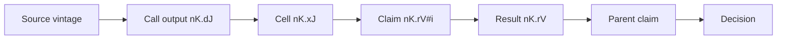
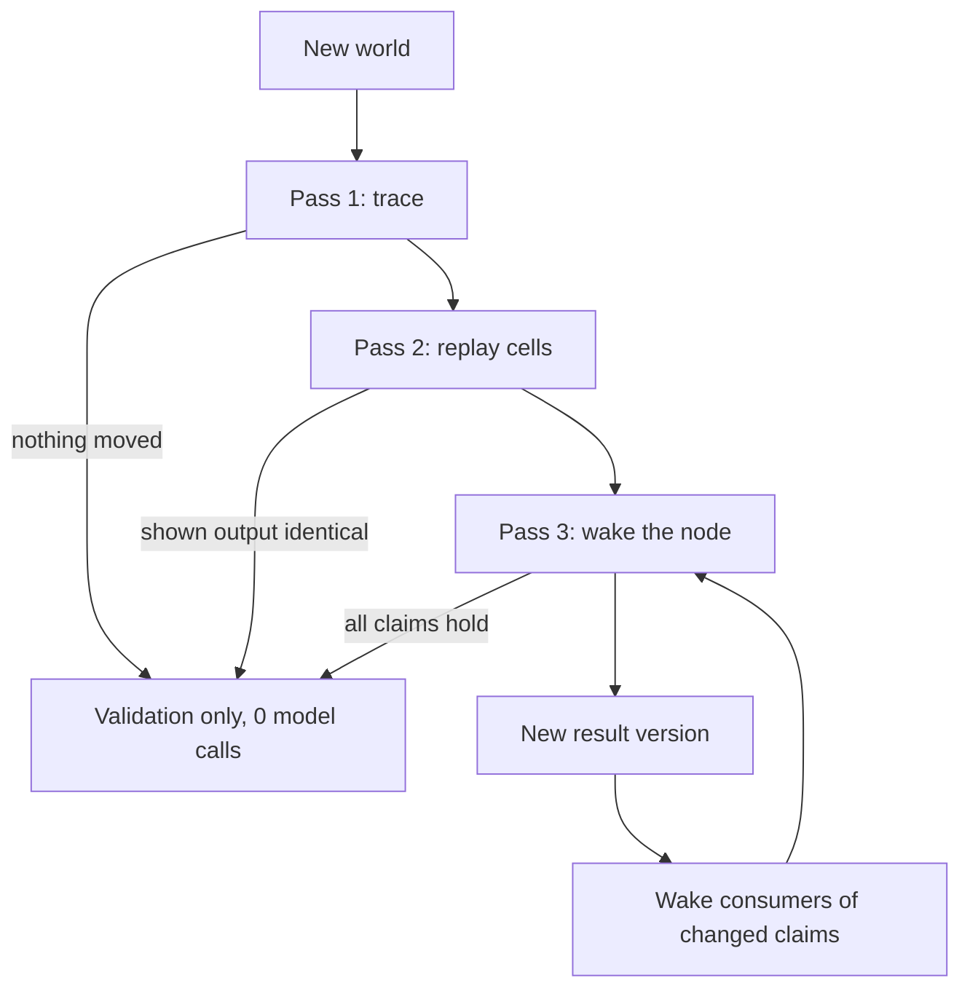

# Investment research harness: specification v5

Async PTC nodes whose every claim cites the records it rests on, so one trace serves delta compute, scenarios, backtests and outcome review.

Status: design, 2026-11-10. Replaces [v3](../harness-spec-v3/README.md) and absorbs the v4 proposal (branch `design/v4-evidence-timelines-ir30`). Nothing here is built except where a line says **measured**; those numbers come from [the sharing experiment](../../experiments/sharing/FINDINGS.md) and [the delta trace prototype](../../experiments/delta/trace.mjs).

This harness is for discretionary investing and portfolio management. It is not a generic agent runtime.

---

## 0. On one screen

- **A node is one task in one PTC session.** It runs a skill or none. Skill-free is the default: a dynamic workflow written by the model, on graph primitives.
- **Six host calls**, unchanged from v3: `readNode`, `readArtifact`, `openNode`, `nextNodeEvent`, `closeNode`, `publishCheckpoint`. A node's final message is its result.
- **Tool calls have identity.** An identical data call in the same world joins the one in flight or reuses its stored output. Every output is a record with a ref.
- **Everything is a record.** Source vintages, worlds, call outputs, cells, model turns, claims, results, validations. Records are immutable and content-addressed. Nothing is edited; a correction is a successor.
- **Every claim is a line that ends in refs.** `Spreads widened 30bp in Q3 to 165bp. [n5.d3]`. The host parses each line into a claim record and checks its refs.
- **One trace.** Source vintage → call output → cell → claim → result → parent claim → decision. The harness records every link; the model only writes the bracketed refs.
- **The delta engine walks that trace in three passes.** Trace what a market delta could touch, replay the affected cells without a model, wake only the nodes whose shown output changed.
- **Forks reuse the same engine.** A scenario, a backtest and an outcome review are each a delta against a different world.
- **Two times on everything:** when the world made it available, and when this system recorded it. Any view can be rebuilt as of any past moment.
- **The harness supplies mechanics and the model supplies judgment.**



---

## 1. What v5 takes from each version

| From | Kept in v5 |
|---|---|
| v1 kernel | Two clocks. Recorded reads. Early cutoff: a change that changes nothing creates no version. Scenario forks as a world copy that re-runs only what moved |
| v3 | The six calls. The request is the identity. The final message is the result. Short versioned refs. Holds and the cascade. Patterns as wrapper code. Caps, not rules |
| v4 | World and vintage inside identity. One append-only journal with views. Bitemporal source records. Four histories (evidence, belief, decision, validation). Negative dependencies for searches. A cumulative-drift anchor. Context fork and world fork as separate axes. Heads moved by compare-and-swap. Compaction as a projection. A tool-effect ledger for recovery |
| Sharing experiment (**measured**) | Call identity: duplicate fetches fell from 3.4 to 0 per run. Data lines with a title and first sentence: the winning arm, 30 of 55 checks against 25 for the same arm without them. Delivery design made no measurable difference, so broadcast is not required |
| Delta prototype (**measured**) | Cell replay as a model-free filter: 1,223 of 1,285 saved cells reproduce their output exactly. Only 912 of 5,993 result lines named a ref, which is why claim lines are now the rule |

**Dropped:**

| Dropped | Why |
|---|---|
| v4's generic-runtime framing and optional investment profile | The harness is for investing. Sources, worlds, forecasts and positions are core records |
| v4's eleven identifiers | Collapsed to run, world, node, entry and record refs |
| v4's per-read grants inside a run | v3's rule stands: any ref in a run is readable by any node in it. Walls sit at the scope of a run's world (section 3.2) |
| v4's typed "consumed exports" as a requirement | Replaced by claim lines. A named claim (section 6.2) gives the same precision without a schema |
| v3's "every line to every node" | The journal is one; each node gets a view (section 5.3) |
| v3's "the root traces cites by hand" | The host computes the trace and the replay. The model still decides what a change means |
| IR-30 as the gate | Too costly to run first (480 episodes at up to $25 each). The delta benchmark in section 14 comes first |

---

## 2. Records and refs

### 2.1 The rule

Every stored thing is a **record**: an immutable payload, a SHA-256 digest, and the two times of section 3. A ref names exactly one record version. A record is never updated or deleted in place.

- A correction is a new record with a `supersedes` edge to the old one.
- "Current" is a **head**: a pointer that moves by compare-and-swap. The pointer's history is itself journaled.
- A **view** (`run`, `nK`, `nK.trail`, a timeline) is computed from records as of a journal position. A view name is not a record; a dependency on a view stores the query and a fingerprint of the result.

### 2.2 Ref grammar

| Ref | Record | Written by |
|---|---|---|
| `s:cpi_yoy@v3` | A source vintage: one published version of a series, document or filing | Ingestion |
| `w7` | A world: an as-of cut of the sources, plus any hypothetical overrides | Host |
| `n5` | A node (view: request, opener, state, holders, refs) | Host |
| `n5.e4` | A trail entry: one model turn, with the manifest of what the model saw | Host |
| `n5.x3` | A cell: code, the calls it made, and the output shown to the model | Host |
| `n5.d3` | A stored call output | Host |
| `n5.c1` | A checkpoint | Node |
| `n5.r2` | A result version | Node (its final message) |
| `n5.r2#4`, `n5.r2#spread_q3` | A claim inside a result or checkpoint, by position or by name | Host, from the node's text |
| `n5.v2` | A validation: a result re-checked against a newer world without changing | Host |
| `n5.trail` | View: the node's entries and cells | Host |
| `you.m1` | A message from you | You |
| `run` | View: the index, one line per node | Host |

Ids follow opening order within a run. Each ref maps to one row in the run's database.

### 2.3 What the identities are

| Identity | What it names | Lifetime |
|---|---|---|
| Run | One standing piece of research and its journal | Open until you close it |
| World | The evidence a piece of work is allowed to see | Immutable |
| Node | A task (its request) and the session that works on it | Stable; results are versioned |
| Entry | A point in a session. The unit a fork cuts at | Immutable |
| Record | Everything else in the table above | Immutable |

A node's trail is a tree of entries, not a list. Reopening appends to the head entry. Forking starts a new branch from an earlier entry. The node's head entry moves by compare-and-swap.

---

## 3. Time and worlds

### 3.1 Times on a source vintage

```json
{
  "ref": "s:cpi_yoy@v3",
  "source": "s:cpi_yoy",
  "kind": "series",
  "event_time": "2026-10",
  "published_at": "2026-11-12T13:30:00Z",
  "available_at": "2026-11-12T13:30:03Z",
  "ingested_at": "2026-11-12T13:30:05Z",
  "supersedes": "s:cpi_yoy@v2",
  "scope": "public",
  "sha256": "…"
}
```

These values are an illustration of the schema, not real release times.

- `event_time` is the period the data describes. It never stands in for availability.
- `available_at` is when a participant with this scope could have had it. A vintage with no reliable `available_at` cannot be read in a backtest.
- `ingested_at` is when this system stored it.
- A read adds a fourth time: the journal position at which a node observed it.

Three questions with three different answers:

| Question | Filter |
|---|---|
| What was knowable at T? | `available_at <= T` and scope |
| What did we know at T? | The above, plus ingested by T, plus a recorded read by T |
| What do we know now about T? | Latest vintage for that `event_time` |

### 3.2 Worlds

A world is the answer to "which vintage does this read return?".

```json
{
  "ref": "w7",
  "parent": "w3",
  "kind": "live | scenario | backtest | hindsight",
  "as_of": "2026-11-12T13:30:03Z",
  "scope": "public",
  "overrides": [{"source": "s:cpi_yoy", "set": {"2026-11": 0.6}, "label": "hot CPI"}],
  "model_cutoff": "2026-06-30"
}
```

```text
resolve(world, source):
  if world.overrides has source:  return synthetic vintage  s:<source>@<world.ref>
  v = latest vintage of source with available_at <= world.as_of and scope allowed
  if v is none:                   fail                      # fail closed, never "latest"
  return v
```

- A live run's world advances as sources arrive: `w3 → w4 → w5`. Each is a new immutable world; "the live world" is a head.
- A world's `scope` is the wall. A run reads only sources its world's scope allows, and a run's records carry that scope. Refs never cross scopes.
- `model_cutoff` records the training cutoff of the model the run uses. A backtest whose `as_of` is earlier than `model_cutoff` is marked **contaminated**: the model may already know the outcome. Point-in-time data rules cannot fix that, so honest backtests use synthetic cases, periods after the cutoff, or a model with an earlier cutoff.

---

## 4. The node and the six calls

### 4.1 The node

A node has:
- **A request**, which is its identity.
- **A world**, inherited from its opener unless the request names one.
- **An opener** and **holders**.
- **Its own session**, recorded as entries and cells.
- **Checkpoints** `nK.c1…` and **results** `nK.r1…`, each parsed into claims.

A node does the *how* itself: tool calls and PTC code. It opens child nodes only for the *what*: parts that are separate judgments.

### 4.2 The calls

| Call | What it does |
|---|---|
| `readNode({node})` | Loads a skill's procedure and links from the pinned registry. Recorded as consulted; nothing runs |
| `readArtifact({ref, offset, limit, at})` | Reads a bounded slice of any record or view in the run. `at` reads a view as of a past journal position or time. The read is recorded |
| `openNode({request})` | Starts a node, joins identical running work, or reuses its latest result. Returns at once with `{node, disp}` |
| `nextNodeEvent({after, filter})` | Returns this node's view of the journal since the cursor, or waits. The same lines are pushed at each turn boundary while the node is busy |
| `closeNode({handle})` | Releases this hold. Unfinished work is cancelled when its last holder leaves |
| `publishCheckpoint({content, to})` | Publishes content as the next checkpoint, parsed into claims. `to` addresses a node or `you` |

**The request:**

| Field | Required | Meaning |
|---|---|---|
| `task` | yes | The one task |
| `node` | no | A skill to run. Omit for a skill-free node |
| `inputs`, `refs` | no | Structured inputs and an ordered ref list |
| `world` | no | A world ref. Default: the opener's world |
| `from` | no | Fork: `{node, entry?, context}`. `context` is `trail` (inherit the session up to `entry`) or `evidence` (inherit only its stored data and claims) |
| `key` | no | Forces a separate copy of otherwise identical work |

**Identity** is the pinned registry and model, plus `task`, `node`, `inputs`, `refs`, `from`, `key` and `world`. Who asks is not part of it.

| Identical work is | `openNode` | Line |
|---|---|---|
| absent | starts a node | `n3 opened n7 · …` |
| running | joins it | `n4 joined n7` |
| finished, and still valid in the caller's world | reuses its latest result | `n4 reused n7.r1` |
| finished in another world | checks its read set in the caller's world (section 9.5); reuses if nothing it read differs, otherwise starts a branch | `n4 reused n7.r1 · valid in w7` |
| failed or cancelled | starts a fresh node | `n1 opened n8 · …` |

**A node cannot end while it holds unfinished work.** Kept from v3.

### 4.3 The world SDK

Data calls are PTC bindings, not model-facing host calls. They go through one dispatcher that enforces the world.

```js
const s = await world.series('utility_spreads')          // {points, unit, ref: 'n5.d3'}
const d = await world.doc('pellham-offering')            // {title, body, ref: 'n6.d2'}
const r = await world.search('utility equity issuance')  // {docs, series, ref: 'n6.d1'}
const v = await load('n2.d4')                            // a stored output, into code, not shown
```

Each call:

```text
world_call(node, tool, args):
  w    = node.world
  key  = hash(tool, canonical(args), read_key(tool, args, w))   # read_key: the vintages or result set w resolves to
  hit  = calls[key]
  if hit and hit.running:   join it;          line "n6 joined n5.d5 · doc pellham-offering"
  elif hit:                 reuse its output; line "n6 reused n5.d5 · doc pellham-offering"
  else:                     fetch under w;  store output as  node.d<J>
                            line "n5.d3 · series utility_spreads · Caldrian utility bond spreads (bp): latest 2026Q3 165"
  record call {ref, tool, args, world, resolved: [vintage refs] | {query, result_fingerprint}, output_sha, by, joined_by}
  return output + {ref, from?}
```

- The first caller owns the ref. A joiner gets the same ref, marked with where it came from. **Measured:** this removed every duplicate fetch.
- A document or series line carries its title and first sentence, or its description and latest point. **Measured:** this was the winning arm.
- A search stores its query and a fingerprint of the result set. That is a **negative dependency**: a later document that would have matched changes the fingerprint.
- `load(ref)` brings stored data into code without printing it. The host records it as processed, not shown.

### 4.4 The wrapper

```js
const r  = await nodes.run(request)        // open, then wait: {node, ref, line}
const op = await nodes.open(request)       // {node, disp}
await op.next(); await op.result(); await op.close()
await nodes.with(request, async op => {})  // scoped, always released
await nodes.next()                         // this node's own view
await nodes.fork({from: {node: 'n7', entry: 'n7.e3', context: 'trail'}, task, world})
await worlds.fork({from: 'w5', overrides: [...], label})   // a new world record; a data-SDK call
await trace.up(ref); await trace.down(ref); await trace.timeline(ref)   // views, through readArtifact
```

Join, fork, settle, steer, race and converge are a few lines each over the six calls. None is a host call.

---

## 5. Cells, entries and the stream

### 5.1 The cell record

A cell is the unit of replay.

```json
{
  "ref": "n5.x3",
  "entry": "n5.e4",
  "code": "const s = await world.series('utility_spreads'); return s.points.slice(-3)",
  "calls": ["n5.d3"],
  "loads": [],
  "reads": [],
  "opens": [],
  "waits": false,
  "shown": "blob:sha256:…",
  "shown_sha": "…",
  "ms": 6120,
  "error": null
}
```

- `shown` is exactly what entered the model's context. Data the code processed but did not return is in `calls` and `loads` only. The two are never conflated.
- A cell is a deterministic function of its code, the interpreter state left by earlier cells, and the outputs of its calls. The host freezes the clock and seeds randomness per cell, and records both.
- A cell that waits on the stream (`waits: true`) depends on what other nodes did. It is not replayed. **Measured:** 31 of 1,285 cells.

### 5.2 The entry record

One entry per model turn:

```json
{
  "ref": "n5.e4",
  "parent": "n5.e3",
  "model": "claude-sonnet-5-5",
  "manifest_sha": "…",
  "pushed_lines": ["n6.d2 · doc pellham-offering · Pellham Power withdraws C$2.4B share offering: …"],
  "output": "blob:sha256:…",
  "cell": "n5.x3",
  "tokens": {"in": 0, "out": 0, "cache_read": 0, "cache_write": 0},
  "cost": 0.0
}
```

The manifest lists what the model saw on this turn: the parent entry, the pushed lines, and the previous cell's shown output. The harness stores what the model was shown and what it wrote. It does not claim to store the model's hidden reasoning.

Compaction is a projection: a summary record that names the entries it stands for. The entries stay.

### 5.3 The stream

There is one journal. `nextNodeEvent` returns a node's view of it.

| Event | Line |
|---|---|
| start | `n2 opened n5 · Can utilities fund 2027 capex through debt?` |
| fork | `n4 opened n9 from n7.e3 in w8 · Under two 2027 hikes, …` |
| join or reuse | `n3 joined n5` · `n4 reused n5.r1` |
| data | `n5.d3 · series utility_spreads · … latest 2026Q3 165` |
| data shared | `n6 joined n5.d5 · doc pellham-offering` |
| checkpoint | `n5.c1 · Utilization measured: 91%.` |
| addressed | `n5.c2 → n8 · We conflict on funding: …` |
| result | `n5.r1 · Debt is open but dearer … · 6 claims, 6 cited` |
| reopen | `n7 reopened · held by n1` |
| validation | `n4.v1 · n4.r1 holds in w6` |
| close, cancel, failure | `n1 closed n2` · `n2 cancelled · no holders left` · `n5 failed · vendor timeout` |

- **Default view:** every line in the run, while the run is small. Lines addressed to the node, or about work it holds, are marked.
- **Filter:** `filter` narrows the view to held work, addressed lines and data lines matching terms. The right default for large runs is not settled (section 15).
- **Nothing is injected.** A line is a first line and a ref. Content is read only when a node chooses to.
- **Messages.** A message to a running node is delivered at its next turn boundary. A message to a finished node reopens it; the sender holds it and pays for it from its own budget. Caps bound this, not rules. **Measured:** nodes sent no messages at all in 186 runs, so runaway reopening is not the problem to design against.
- **Budget:** every batch ends with the budget left.

---

## 6. Inline citation: the claim line

This is the primitive the rest of the engine stands on.

### 6.1 Grammar

A result or checkpoint is free prose. Each line that asserts something ends with the refs it rests on, in square brackets.

```text
line    := [name ":=" value " · "] text " [" cite { " " cite } [ "; review by " date ] "]"
cite    := ref | "#" local | "assume"
ref     := nK.dJ | nK.xJ | nK.cJ | nK.rV | nK.rV#id | you.mJ
local   := a position or name of an earlier claim in this same artifact
```

```markdown
**Debt is open but dearer, so plans slip rather than cancel.** [#1 #2 #3]

- spread_q3 := 165bp · Utility bond spreads widened 30bp in Q3 to 165bp. [n5.d3]
- Norvane priced a C$1.1B bond in Q3, more than twice its C$450M tender. [n5.d2 n5.d6]
- Equity is shut: Pellham pulled its C$2.4B offering on 14 October. [n6.r1#1]
- Pellham keeps its Q1 2027 tender on schedule. [assume; review by 2027-01-15]
```

Three kinds of claim fall out of what a line cites:

| Kind | Cites | Meaning |
|---|---|---|
| Evidence | A call output or a cell | A fact read from data |
| Derived | Other claims, here or in another node | An inference; it moves when they move |
| Assumption | `assume` | A premise the node takes without evidence. The list of these is the thesis's exposure |

Headings and lead-in lines ending in a colon are framing and need no refs.

### 6.2 Named claims

A claim may carry a name and a value: `cuts_2027 := 1 · Futures price one cut in 2027. [n2.x2]`.

- The name is stable across versions, so `n2.r1#cuts_2027` and `n2.r2#cuts_2027` can be compared exactly.
- A consumer that cites `n2.r1#cuts_2027` depends on that value and nothing else in `n2.r1`.
- A skill can declare the names its node must publish. A skill-free node names what it expects others to use.

### 6.3 What the host does on publish

```text
publish(node, text, kind):                         # kind: checkpoint | result
  claims = parse_claim_lines(text)
  for c in claims:
    for cite in c.cites:
      require exists(cite) and version_pinned(cite)             # else reject, naming the cite
      require cite in observed(node)                            # shown, loaded, read, or pushed to this node
      require world_ok(cite, node.world)                        # same world, or valid in it (section 9.5)
      if cite is local: require cite refers to an earlier line  # keeps claims acyclic
    c.kind     = evidence | derived | assumption
    c.unquoted = numbers(c.text) not found in the cited records  # a flag, not a rejection
  uncited = assertion lines with no brackets
  if uncited and node has not been told once:
    return notice("These lines cite nothing: … Add refs, or mark them [assume].")
  in one transaction:
    store artifact, claims, cites edges, supersedes edges
    append journal event with the line  "n5.r1 · <first line> · 6 claims, 6 cited"
```

- **Cited must be observed.** A node cannot cite a record it never saw. This is checked, not trusted.
- **The host checks integrity, not truth.** It proves the ref exists, is pinned and was seen. Whether the data supports the sentence is the model's judgment, or a reviewer node's.
- **An uncited line is still traceable, coarsely.** It is treated as resting on everything the node was shown. The engine stays correct and loses precision.
- **Why this is a rule now. Measured:** with refs available but not required, 15% of result lines named one. A spreads revision reached the right node and the right thesis section but no claim.

### 6.4 Revisions

A revised result is a full new claim list. For each prior claim the node does one of three things:

```markdown
- #1 holds
- #2 · Utility bond spreads widened 55bp in Q3 to 190bp. [n5.d7]
- Norvane's deal now looks like the exception, not the market. [#2 n5.d2]
```

| Written | Host records |
|---|---|
| `#i holds` | The prior claim is carried forward byte-identical, with a `held` edge |
| `#i · new text [refs]` | A successor claim with a `supersedes` edge |
| A line with no `#i` | A new claim |
| A prior claim not mentioned | Withdrawn, with a `withdrawn` edge |

If every claim holds, no new result version is created. The host appends a validation record instead. That rule is early cutoff.

---

## 7. The trace

### 7.1 Edges

All edges are recorded by the host. The model writes only the bracketed refs.

| Edge | From → to | Recorded when |
|---|---|---|
| `resolved` | Call → source vintage, or search → result fingerprint | The call runs |
| `made`, `loaded` | Cell → call output | The cell runs |
| `read` | Cell → artifact | `readArtifact` |
| `shown` | Cell → entry | The output enters the context |
| `pushed` | Line → entry | A line is delivered at a turn boundary |
| `cites` | Claim → record | Publish |
| `held`, `supersedes`, `withdrawn` | Claim → prior claim; result → prior result; vintage → prior vintage | Publish, ingestion |
| `opened`, `holds`, `forked_from` | Node → node; entry → entry; world → world | `openNode` |
| `validated` | Validation → result, in a world | The delta engine |

Two tiers of dependency:

- **Cited:** a claim names the record. Precise.
- **Exposed:** the node was shown the record but no claim names it. From the entry where it was shown, everything later in that session is exposed. Conservative.

### 7.2 Queries

These are views read through `readArtifact`, wrapped as `trace.*`.

```text
up(ref):                         # what does this rest on?
  claim    → its cites
  result   → its claims
  cell     → its calls, loads and reads
  call     → its source vintages
  stop at source vintages and assumptions

down(ref):                       # what rests on this?
  vintage  → calls that resolved to it
  call     → cells that made or loaded it
  cell     → (cited)   claims citing the cell or its calls
             (exposed) the node's later entries, then its results
  claim    → claims citing it, in any node
  result   → cells that read it

timeline(decision):              # the evidence timeline of a thesis
  rows = []
  for version in versions(decision):
    for claim in version.claims:
      for leaf in leaves(up(claim)):                  # source vintages and assumptions
        rows.add({
          available_at: leaf.available_at,            # when the world had it
          observed_at:  first read of leaf in this run,   # when we had it
          source:       leaf.ref,
          path:         leaf → call → cell → claim → … → decision claim,
          effect:       which claim versions it first appeared under,
        })
  return rows sorted by available_at

at(view, T):                     # any view as of a past moment
  rebuild the view from records with recorded_at <= T and heads as they stood at T
```

`timeline` answers "what did this decision rest on, when did each piece exist, and when did we see it?". `at` answers "what did we hold on that date, and why?".

---

## 8. Storage

### 8.1 Layout

One SQLite database in WAL mode per book, content-addressed blobs for payloads, and Parquet for market series. Runs share the source and world tables, so one release reaches every thesis that reads it.

```sql
CREATE TABLE events (            -- the journal: the only append point
  seq INTEGER PRIMARY KEY AUTOINCREMENT,
  run TEXT NOT NULL, node TEXT, actor TEXT NOT NULL,
  kind TEXT NOT NULL, ref TEXT, line TEXT,
  caused_by TEXT,                -- JSON array of seq
  world TEXT, recorded_at TEXT NOT NULL, scope TEXT NOT NULL
);
CREATE TABLE records (           -- every immutable payload
  ref TEXT PRIMARY KEY, kind TEXT NOT NULL, sha256 TEXT NOT NULL,
  blob TEXT NOT NULL, run TEXT, node TEXT, world TEXT,
  seq INTEGER NOT NULL, scope TEXT NOT NULL
);
CREATE TABLE vintages (
  ref TEXT PRIMARY KEY, source TEXT NOT NULL, kind TEXT NOT NULL,
  event_time TEXT, published_at TEXT, available_at TEXT, ingested_at TEXT NOT NULL,
  supersedes TEXT, scope TEXT NOT NULL, sha256 TEXT NOT NULL
);
CREATE TABLE worlds (
  ref TEXT PRIMARY KEY, parent TEXT, kind TEXT NOT NULL,
  as_of TEXT NOT NULL, scope TEXT NOT NULL, overrides TEXT, model_cutoff TEXT
);
CREATE TABLE nodes (
  run TEXT, id TEXT, request TEXT NOT NULL, identity TEXT NOT NULL,
  opener TEXT, world TEXT NOT NULL, PRIMARY KEY (run, id)
);
CREATE TABLE entries (
  ref TEXT PRIMARY KEY, parent TEXT, run TEXT, node TEXT,
  model TEXT, manifest_sha TEXT, output TEXT, seq INTEGER NOT NULL
);
CREATE TABLE cells (
  ref TEXT PRIMARY KEY, entry TEXT NOT NULL, code TEXT NOT NULL,
  shown TEXT NOT NULL, shown_sha TEXT NOT NULL, waits INTEGER, error TEXT, clock TEXT, seed TEXT
);
CREATE TABLE calls (
  ref TEXT PRIMARY KEY, identity TEXT NOT NULL, tool TEXT NOT NULL, args TEXT NOT NULL,
  world TEXT NOT NULL, resolved TEXT NOT NULL, output_sha TEXT NOT NULL,
  effect TEXT NOT NULL            -- planned | started | committed | failed
);
CREATE TABLE claims (
  ref TEXT PRIMARY KEY, artifact TEXT NOT NULL, pos INTEGER NOT NULL, name TEXT, value TEXT,
  text TEXT NOT NULL, kind TEXT NOT NULL, review_by TEXT, unquoted INTEGER
);
CREATE TABLE edges (
  src TEXT NOT NULL, rel TEXT NOT NULL, dst TEXT NOT NULL, seq INTEGER NOT NULL,
  PRIMARY KEY (src, rel, dst, seq)
);
CREATE TABLE heads (             -- the only mutable table; every move is also an event
  name TEXT PRIMARY KEY, ref TEXT NOT NULL, revision INTEGER NOT NULL
);
CREATE TABLE validations (
  ref TEXT PRIMARY KEY, result TEXT NOT NULL, from_world TEXT NOT NULL, to_world TEXT NOT NULL,
  coverage TEXT NOT NULL, seq INTEGER NOT NULL
);
```

### 8.2 The publish transaction

```text
commit(record, edges, event, head_move?):
  1. canonicalize; compute sha256; validate refs and scope
  2. write the blob to staging, flush, move to its content address
  3. in one database transaction:
       insert record, edges and event
       if head_move: update heads where name = ? and revision = expected   # compare-and-swap
  4. commit
```

No event ever names a missing blob. A lost head race leaves the record stored as an unadopted candidate.

### 8.3 Rules

- **Append-only.** The journal, records, vintages, worlds, entries, cells, calls, claims, edges and validations are never updated.
- **Projections are rebuildable.** The index, the trace queries and the timelines are computed from the tables above. Dropping and rebuilding them must reproduce the same output.
- **Recovery** resumes at the last committed cell. The `effect` column on a call says whether it was planned, started or committed; a replay uses committed outputs and does not repeat them. The harness does not promise exactly-once effects outside itself.
- **Retention.** A payload removed for a legal reason leaves a tombstone with its digest and times. Views over it report that the content is unavailable.

---

## 9. The delta engine

### 9.1 Four histories

A standing thesis keeps four histories that move at different rates.

| History | Records | Moves when |
|---|---|---|
| Evidence | Source vintages, call outputs | The world publishes |
| Belief | Claims, especially named ones | A node revises a claim |
| Decision | The root's result versions | The root's action or a claim it rests on changes |
| Validation | `nK.vJ` | A result is re-checked against a newer world and holds |

A probability can move while the action holds. Consumers of that probability are woken; consumers of the action are not.

### 9.2 The three passes



```text
delta(run, w_new):
  w_old = run.validated_world
  pin(w_new)

  # ---------- pass 1: trace (no model) ----------
  moved = []
  for call in calls(run):
    if read_key(call.tool, call.args, w_new) != call.resolved:      # new vintage, or a search's result set changed
      moved.add(call)
  due = [c for c in live_claims(run) if c.review_by and c.review_by <= w_new.as_of]

  if moved is empty and due is empty:
    append validation(run.root.head, w_old → w_new, coverage: "resolved every call; none moved")
    run.validated_world = w_new
    return NOOP                                                      # 0 model calls, no new version

  # ---------- pass 2: replay (no model) ----------
  diffs = {}                                                         # node → list of shown-output diffs
  exposed = set()
  for node in nodes that made or loaded a moved call:
    first = earliest cell of node touching a moved call
    state = interpreter state before `first`                         # restored by re-running earlier cells on stored outputs
    for cell in node.cells from first:
      if cell.waits:                                                 # depends on the stream, not on data
        if cell touches moved: diffs[node].add(unreplayable(cell))
        continue
      out = run(cell.code, state, world = w_new, clock = cell.clock, seed = cell.seed,
                node calls answered from the record)
      if out made a call the saved cell never made: diffs[node].add(new_path(cell, out))
      elif sha(out.shown) != cell.shown_sha:        diffs[node].add(diff(cell.shown, out.shown))
    if node not in diffs: exposed.add(node)

  report = impact_report(moved, due, diffs, exposed)                 # section 9.3; available before any spend

  # ---------- pass 3: revise (model) ----------
  queue = nodes in diffs, plus owners of `due` claims, ordered children before parents
  while queue not empty:
    n = queue.pop()
    candidate = revise(n, diffs[n], w_new)                           # section 9.4
    d = claim_diff(n.head_result, candidate)                         # held / superseded / withdrawn / new
    if d is empty:
      append validation(n.head_result, w_old → w_new, coverage: diffs[n])
      continue                                                       # early cutoff: no version, nobody above wakes
    publish n.r(V+1) with supersedes and held edges; move n's head by CAS
    for p in consumers(n):                                           # nodes that cite n's claims or were shown n's result
      touched = claims of p citing a claim in d
      if touched or p was shown n.r(V):                              # the conservative rule; "cited only" is the cheaper setting
        diffs[p].add(d); queue.add(p)

  for n in exposed: append validation(n.head_result, w_old → w_new, coverage: "replayed; shown output identical")
  if latest_world() == w_new: run.validated_world = w_new
  else:                       schedule delta(run, latest_world())    # a refresh never certifies a world it did not see
  return report
```

Rules the pseudocode relies on:

- **A refresh pins its world.** Evidence that arrives mid-refresh waits for the next one. Bursts are coalesced by scheduling, never by dropping vintages.
- **Unreplayable means changed.** A cell that cannot be replayed and touched moved data wakes its node.
- **A held claim is byte-identical.** That is what lets a parent's replay see no change.
- **Heads move by compare-and-swap.** Two refreshes racing on one decision leave one head and one stored candidate.

### 9.3 The impact report

Passes 1 and 2 produce this before any model runs. The example is a spreads revision on a saved run. Every line except `Claims` is what the prototype **measured**; the `Claims` line is what claim lines add, since that run's results cited no data ref.

```text
Moved:        s:utility_spreads@v1 → @v2   (2026Q3: 165bp → 190bp)
Calls:        n5.d3
Cells:        n5.x3 read it; shown output changed
Woken:        n5
Wait on n5:   n3, n1
Untouched:    n2, n4, n6            (3 of 6 nodes, 0 model calls)
Claims:       n5.r1#spread_q3 cites n5.d3;  n3.r1#2 cites it;  n1.r1#financing cites n3.r1#2
Decision:     financing at risk;  demand and pricing hold
```

Three other deltas on the same run needed no model at all: a duplicate release, a new document nobody had searched for, and a corrected unit label that one cell read but did not print.

### 9.4 Waking a node

Two ways, both recorded, both producing `nK.r(V+1)` or a validation.

```text
revise(n, diffs, w_new, mode):
  if mode == "reopen":
    append to n's head entry a message:
      what moved:        source, old → new vintage, available_at
      what you saw then: the old shown output of each changed cell
      what it shows now: the new shown output, as a diff
      your claims that cite it: n.rV#i …
      drift since the decision last changed: spread_q3  130 → 165 → 190
      "For each of your claims, write `#i holds` or rewrite it. End with your result."
    continue the session in w_new
  if mode == "fork":
    cut = entry before the first changed cell
    start a branch of n's trail from cut, in w_new        # the prefix and its prompt cache are reused
    the model re-runs its work from there and writes a full result
```

| | Reopen | Fork |
|---|---|---|
| Cost | Lower: one message on a warm or cold session | Higher: the tail of the session is redone |
| Anchoring | The node has its old conclusion in context | The node never saw its old conclusion |
| Use when | The change is a revision to data the node already weighed | The change breaks the path the node took |

Which is better, and when, is the first thing to measure (section 15).

**Cumulative drift.** Each wake message shows every named claim's value at the last world where the decision changed, not just the previous value. A slide of 68% → 65% → 61% → 57% → 53% never looks small on its last step.

### 9.5 Reuse across worlds

The same check decides whether stored work is valid in a different world:

```text
valid_in(result, w):
  for call in calls under up(result):
    if read_key(call.tool, call.args, w) != call.resolved: return false
  return no claim under result is past its review_by at w.as_of
```

A scenario world that overrides CPI therefore shares every node that never read CPI. This is what makes forks cheap.

### 9.6 Outcomes

| Outcome | Records appended | Model calls |
|---|---|---|
| No-op | One validation | 0 |
| Replayed, identical | One validation per exposed node | 0 |
| Reassessed, holds | One validation per woken node | 1 per woken node |
| Belief revision | New result versions below the root; root validated | 1 per node on the path |
| Decision revision | A new root version with `supersedes` edges to the claims that changed | 1 per node on the path |

---

## 10. Forks: scenarios, backtests and outcome review

Two fork axes, independent of each other:

| Axis | What is copied | What is new |
|---|---|---|
| World fork | Every record, by reference | A world with overrides or a different `as_of` |
| Context fork | A session prefix up to an entry | The task, and the reasoning after the cut |

A **branch** is a set of heads over shared records. Creating one copies nothing.

### 10.1 Scenario

```text
scenario(run, overrides, label, p?, resolution_rule?):
  w_s = worlds.fork({from: run.world, overrides, label, kind: "scenario"})
  b   = branch(run, world = w_s)                 # heads only
  delta(b, w_s)                                  # the same engine; the base heads never move
  publish scenario record {branch: b, world: w_s, overrides, p, resolution_rule, decision: b.root.head}
```

- A scenario's probability and resolution rule are frozen when it is published. A changed view is a new scenario record.
- If scenario probabilities sum to one, the scenarios must be mutually exclusive and exhaustive.
- For independent bull and bear cases, give two fresh nodes the same world and `context: evidence`. A trail fork inherits the first analyst's framing.
- A scenario can be stored without being run. It is then a spec with a trigger, instantiated later against the world of that day.

### 10.2 Convergence

Three different things, kept apart:

| Kind | What happens |
|---|---|
| Computational | Identical work joins one execution |
| Epistemic | A new node cites both branch results and publishes a reconciliation. It can preserve the disagreement |
| State | An authorized head move adopts one candidate. The loser stays stored |

Trails are never merged.

### 10.3 Backtest

```text
backtest(task, T, scope):
  w_b = worlds.at({as_of: T, scope, kind: "backtest"})
  run the task in w_b                            # every read fails closed without a vintage available by T
  mark contaminated if T < w_b.model_cutoff
```

To ask what the live book held on a past date, no run is needed: `trace.at(decision, T)` rebuilds the decision, its claims and its timeline as of T from stored records.

### 10.4 Outcome review

Today's decision rests on a forecast of tomorrow's release. Tomorrow the release arrives. Three things happen, and none of them edits yesterday's records.

```text
on_outcome(run, actual):                         # actual: a new source vintage, available at T1
  # 1. The live thesis moves forward.
  delta(run, world_after(actual))                # may publish decision r2

  # 2. The forecast is scored.
  for f in forecasts(run) whose resolution_rule matches actual:
    append resolution {forecast: f, outcome: actual, score: rule(f, actual)}      # f itself is never edited

  # 3. Hindsight: what would we have concluded with the true value?
  r1  = the decision version held at T0
  w_h = worlds.fork({from: r1.world, overrides: [actual as an override], kind: "hindsight"})
  b_h = branch(run at r1, world = w_h)
  delta(b_h, w_h)                                # forks the saved sessions at the cells that read the forecast
  lesson = claim_diff(r1, b_h.root.head)
  publish lesson {decision: r1, hindsight: b_h.root.head, actual,
                  wrong_claims: lesson.superseded, failed_assumptions: assumptions of r1 contradicted in w_h}
```

- The gap between `r1` and the hindsight branch separates a bad call from bad luck: which claims would have changed with the true number, and which would not.
- A hindsight branch that matches a scenario branch is **not** promoted. Its other overrides may still be wrong.
- Lessons are records, cited like any other. A later node can cite `lesson` the way it cites data.

---

## 11. Skills

A skill-free node and a skill node run on the same host path.

| | Skill-free | With a skill |
|---|---|---|
| Procedure | The model writes it | Read from the graph with `readNode` |
| Children | The model decides | The skill's links suggest them |
| Named claims | The node names what others will use | The skill declares names its node must publish |
| Review dates | The node sets `review by` | The skill sets defaults |
| Resolution rules | Written per forecast | Declared once |

A skill never changes what the host records. It makes a recurring task's outputs line up from one run to the next, which is what lets the delta engine compare them exactly. A skill revision invalidates only nodes that consulted the old version.

---

## 12. The book

- **A thesis is a standing run.** Its root result is the decision, with an action, named claims and assumptions.
- **A position rests on claims:** `{instrument, size, rests_on: [n1.r3#action, n1.r3#size_cap]}`. When one of those claims is superseded, the position is flagged for review. The harness never trades.
- **One evidence store for the book.** Sources, vintages and worlds are shared across runs within a scope.

```text
on_ingest(vintage):
  w = advance(live_world, vintage)
  for run in standing runs in vintage.scope:
    if any call of run resolves vintage.source, or any stored search would now match it:
      schedule delta(run, w)
    else:
      append validation(run.root.head, coverage: "source not read")       # 0 model calls
```

One CPI print reaches every thesis that read CPI, and only those.

---

## 13. Walkthrough

One question, four moments. Refs and values are illustrative.

**T0 · the decision.** You ask whether to add to XLI LEAPS. The root opens three nodes in world `w3`.

```text
n1  Should we add to XLI LEAPS this month?                       world w3
├─ n2  Rate path for 2027                    n2.d1 = series cpi_yoy → s:cpi_yoy@v2
├─ n3  Industrial demand                     n3.d1…d4
└─ n4  Are the LEAPS fairly priced?          n4.d1…d3
```

```markdown
n2.r1
- cuts_2027 := 2 · Futures price two cuts in 2027. [n2.x2]
- October CPI was 0.3% m/m, in line. [n2.d1]
- November CPI prints at or below 0.3%. [assume; review by 2026-12-11]

n1.r1
- action := add · Add a half position now. [#2 #3 #4]
- Two cuts support multiples. [n2.r1#cuts_2027]
- Orders are rising. [n3.r1#1]
- Implied volatility is at its median. [n4.r1#iv]
```

**T1 · a revision.** October CPI is revised to 0.4%. `s:cpi_yoy@v3` arrives; the live world becomes `w4`.

```text
pass 1   moved: n2.d1.  n3 and n4 never read CPI.
pass 2   n2.x2 replayed: shown output changed (2 cuts → 1 cut).
pass 3   n2 reopened  →  n2.r2: cuts_2027 := 1, #2 superseded, #3 holds
         n1 woken with the claim diff  →  n1.r2: action := add holds; "one cut" replaces "two cuts"
records  n2.r2, n1.r2, n3.v1, n4.v1.   Model calls: 2.   Untouched: n3, n4.
```

**T1 · a scenario.** Before the next print you ask "what if November is 0.6?".

```text
w_s = worlds.fork({from: w4, overrides: [{source: s:cpi_yoy, set: {2026-11: 0.6}}], label: "hot CPI"})
branch b_s:  n3 and n4 reused (valid in w_s).  n2 forked from n2.e2  →  cuts_2027 := 0
             n1 on b_s  →  action := wait
scenario record: {world: w_s, p: 0.2, resolution_rule: "November CPI m/m >= 0.5", decision: b_s:n1.r1}
```

The live heads did not move.

**T2 · the outcome.** November prints 0.5.

```text
1. delta(live, w5)     n2.r3: cuts_2027 := 0;  the assumption "at or below 0.3%" is withdrawn
                       n1.r3: action := trim
2. resolution          scenario "hot CPI" resolves true; forecast p = 0.2 is scored and kept
3. hindsight           w_h = w3 + the true November value.  b_h:n1 → action := wait
   lesson              At T0 the add rested on one assumption. With the true print, the call flips.
                       wrong_claims: n1.r1#action.   failed_assumptions: n2.r1#3.
```

`trace.timeline(n1)` now returns every vintage the decision ever rested on, in the order the world published them, with the time this run first read each and the claim versions each one changed. `trace.at(n1, T0)` still returns `n1.r1` exactly as it stood.

---

## 14. Conformance tests and the first benchmark

**Records and time**
- Crash at each step of the publish transaction: no event names a missing blob.
- Rebuild every projection from the journal and blobs: same output.
- A backtest world never returns a vintage with `available_at` after its `as_of`; a source with no `available_at` fails.
- `at(view, T)` returns the same bytes before and after later revisions.

**Calls and identity**
- Two identical data calls in one world: one fetch, one ref, two holders.
- The same call in two worlds that resolve to different vintages: two fetches.
- Same request with `key`: two executions.

**Claims**
- A cite of a record that does not exist, is unpinned, or was never observed by the node: rejected, naming the cite.
- A local cite of a later line: rejected.
- A revision where every claim holds: no new version, one validation.

**Delta engine**
- 100 refreshes against an unchanged world: 0 model calls, 0 new versions.
- A new document matching no stored search: 0 nodes woken; the document is stored.
- A new document matching a stored search: that search's node is woken.
- A revision to a value a cell read but did not show: 0 nodes woken.
- Same action, revised probability: consumers of the probability are woken, consumers of the action are not.
- Five small moves in one direction: the wake message shows the drift since the decision last changed.
- Evidence arriving mid-refresh: the refresh validates only its pinned world.
- A claim past its `review by` date with no new data: its node is woken.

**Forks**
- A fork from an entry keeps its cut after the parent continues.
- A scenario world leaves every live head unchanged.
- Two head moves on one decision: one wins, both candidates stored.
- An outcome never edits the forecast it resolves.

**The first benchmark** is the delta benchmark, not IR-30. Take finished runs as standing theses, inject planted deltas of each kind above, and score against planted truth:

| Measure | Meaning |
|---|---|
| Recall of the impact set | Did it contain every claim that should change? |
| Precision of the impact set | How much was woken for nothing? |
| Model calls and cost | Against a full re-run |
| Revision quality | Is the revised thesis right, graded blind? |
| Missed revisions | Material deltas that left the decision unchanged |

Arms: full re-run; v3's root-traces-by-hand; trace and reopen; trace and fork; cited-only against wake-on-exposed.

---

## 15. Open decisions

| Decision | Default taken here | What would settle it |
|---|---|---|
| Reopen or fork when waking a node | Both supported; reopen first | The delta benchmark |
| Wake on exposed data, or on cited data only | Wake on exposed | Missed revisions against cost, in the benchmark |
| How hard to enforce claim lines | One notice, then accept and record coverage | Coverage and trace precision in live runs |
| Who names claims | The node; a skill may require names | Whether skill-free names stay stable across revisions |
| Default stream view in large runs | Everything, until a cap | The larger-run test that was designed but not run |
| Outcome review in the first live experiment | After delta compute is measured | Your call |
| Model look-ahead in backtests | Flag as contaminated; prefer synthetic or post-cutoff cases | Whether an earlier-cutoff model is available |

---

## 16. Build order

1. **Records.** Journal, blobs, the publish transaction, heads, `at`. Exit: the records-and-time tests pass.
2. **Worlds and the data SDK.** Vintages, `resolve`, call identity, data lines. Exit: the identity tests pass.
3. **Cells, entries and claim lines.** The cell record with frozen clock and seed, the claim parser, the publish checks, revisions. Exit: the claim tests pass; coverage above 90% in live skill-free runs.
4. **Trace and replay.** `up`, `down`, `timeline`, passes 1 and 2, the impact report. The prototype already does this on saved runs.
5. **Pass 3.** Reopen and fork, early cutoff, validations, drift. Exit: the delta-engine tests pass; the benchmark is run.
6. **Forks.** World forks, branches, scenarios, backtests, outcome review. Exit: the fork tests pass.
7. **The book.** Shared evidence across runs, positions resting on claims, fan-out on ingest.

Each step is useful without the next. Steps 1 to 4 need no change to how nodes coordinate, so they can be built on the experiment harness as it stands.
